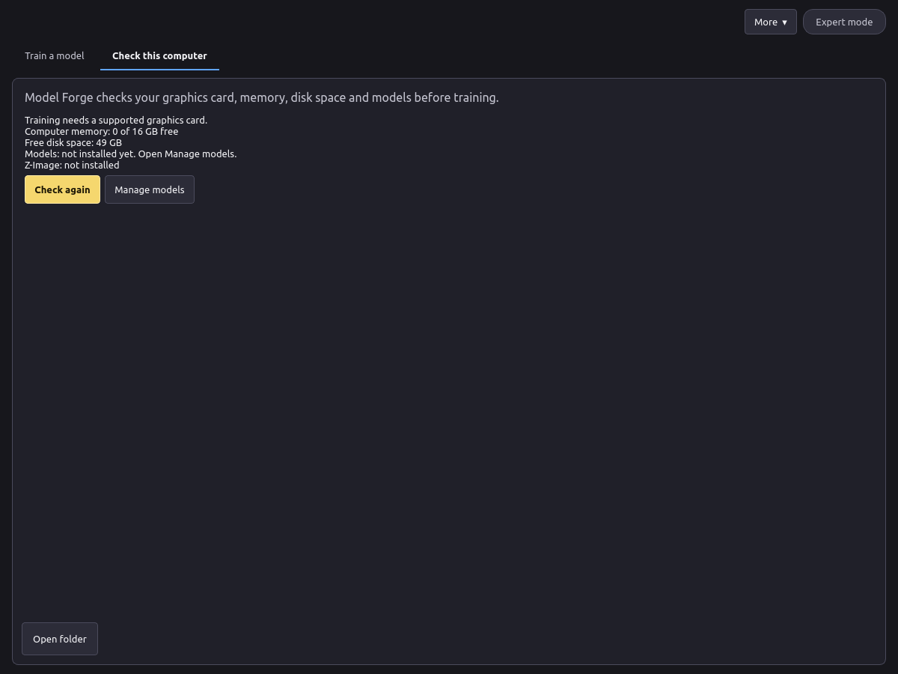
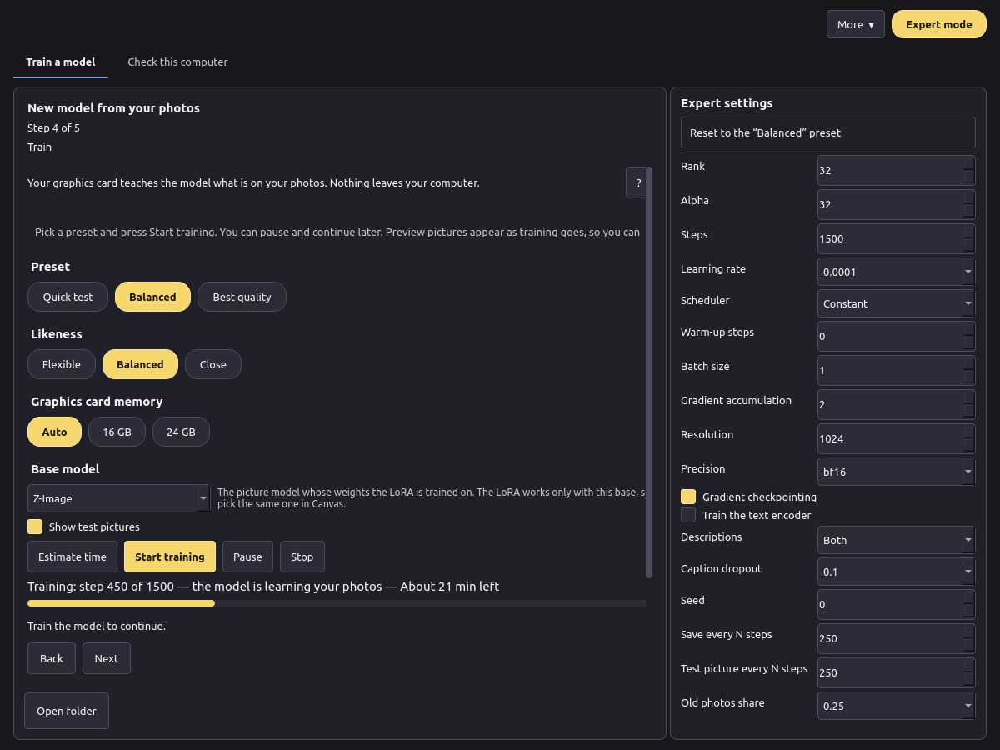
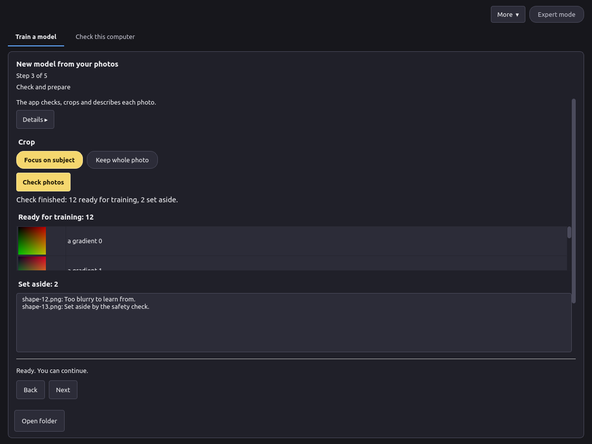
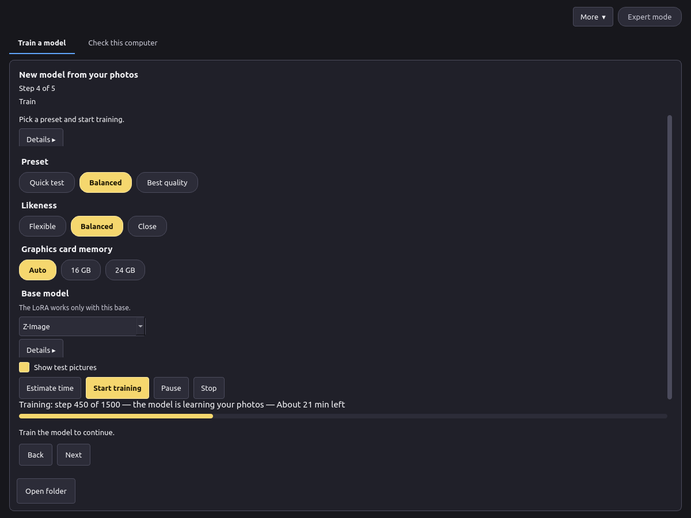
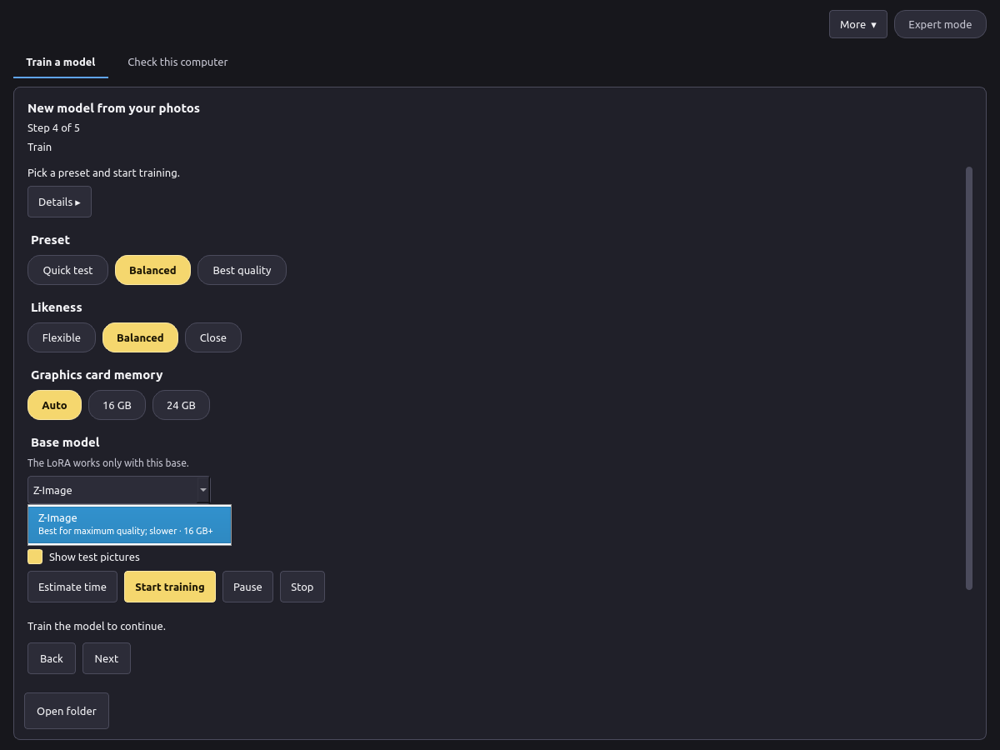
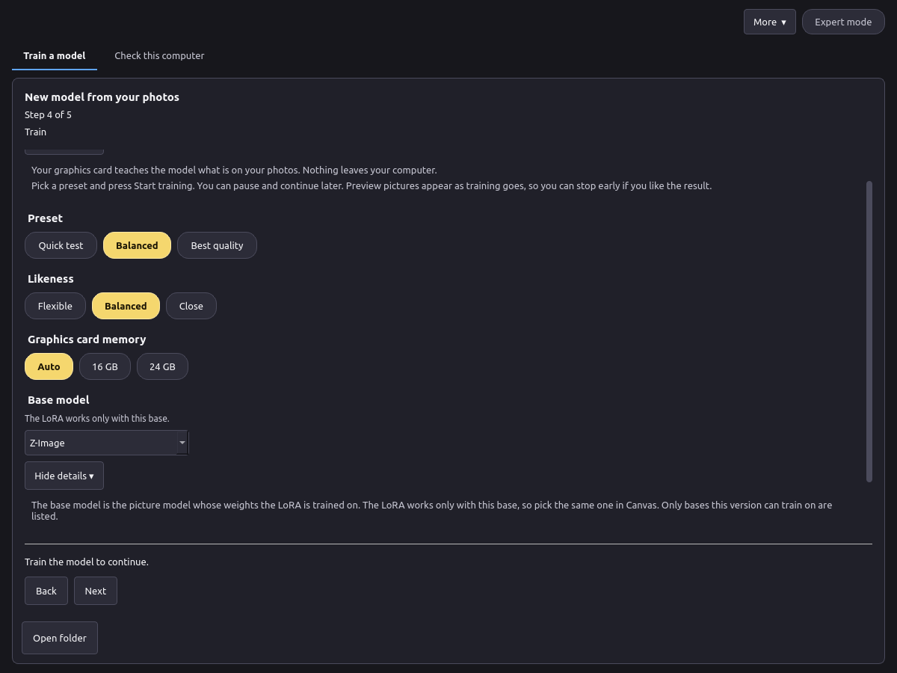
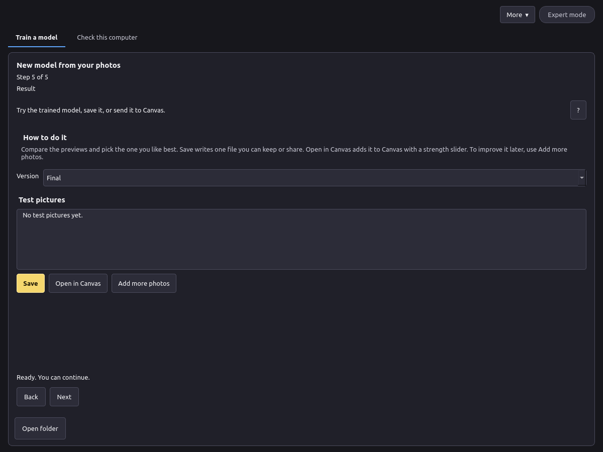

# VOXPrint AI Model Forge: user manual

*Version 0.1. [Русская версия](ru.md).*

Pictures marked **Screenshot placeholder** will be added later.

## 1. What Model Forge is

Model Forge teaches a picture model something new from your own photos: a person, an object or a style. The result is a small add-on file called a LoRA. You can use it in VOXPrint AI Canvas to make new pictures of that person, object or style.

Everything happens on your computer. Your photos, the descriptions and the trained model are not uploaded anywhere.

Model Forge has a few more tools for advanced users (model conversion, measurements). This manual covers training a LoRA.

## 2. Requirements and install

**Requirements**

| | Minimum |
| --- | --- |
| System | Windows 11 24H2 or newer, 64-bit. Linux works from source (see the README). |
| Graphics card | NVIDIA with 16 GB of video memory (24 GB is faster), RTX 30-series or newer |
| Driver | A current NVIDIA driver |
| Disk | About 45 GB free: about 35 GB for the models, plus the app and your projects |
| Internet | Needed for the install and the first model download only |

The figures for memory and time will be updated after the final GPU tests.

**Install on Windows**

1. Run `VoxprintModelForgeSetup.exe` and confirm the administrator prompt.
2. The setup copies the app to `C:\Program Files\VOXPrint AI Suite\Model Forge`, then downloads Python and the libraries it needs. This takes a few minutes. Keep the computer online.
3. When it finishes, open **VOXPrint AI Model Forge** from the Start menu folder **VOXPrint AI Suite**.

If the setup fails, it shows the path to its log: `C:\Program Files\VOXPrint AI Suite\Model Forge\setup-work\install.log`.

> **Screenshot placeholder:** the setup window while it installs.

To remove the app, use **Uninstall VOXPrint AI Model Forge** in the same Start menu folder, or Windows Settings. Your projects and downloaded models stay in place (see section 7).

## 3. First launch: model download, sources, licences, disk

Model Forge needs some models before it can train. They are not inside the setup, so it stays small. On the first launch, open **Check this computer** and press **Manage models**. The VOXPrint model downloader (MDL) opens and lists what is missing.

| Model | What it does | Source | Licence | Size |
| --- | --- | --- | --- | --- |
| Z-Image (base) | The picture model the LoRA is trained on | Tongyi-MAI/Z-Image | Apache-2.0 | 20.5 GB |
| Qwen3-VL-4B-Instruct | Writes photo descriptions and checks every photo | Qwen/Qwen3-VL-4B-Instruct | Apache-2.0 | 8.9 GB |
| MiVOLO v2 | Estimates age from faces (safety check) | iitolstykh/mivolo_v2 | Apache-2.0 | 0.1 GB |
| YuNet (2023mar) | Finds faces for the age check | opencv/opencv_zoo | MIT | under 1 MB |
| Florence-2-large | Backup description writer | microsoft/Florence-2-large | MIT | 3.1 GB |
| MOSS-Image Base | A second base model (optional, coming later) | OpenMOSS-Team/MOSS-Image-Base | Apache-2.0 | 27.2 GB |

- **Sources.** Every model is downloaded from its author's official page, at a fixed version. The downloader checks each file against its published checksum before it is used.
- **Licences.** Each model keeps its own licence. Read it in Manage models before you use the model. Your LoRA inherits the licence of the base model it was trained on.
- **Disk.** Models go to the shared VOXPrint models folder, by default `%LOCALAPPDATA%\Voxprint\models`. Other VOXPrint apps use the same folder, so a model is downloaded only once. Downloads continue in the background if you close the downloader window, and they resume after an interruption.

> **Screenshot placeholder:** Manage models with the Model Forge models.

## 4. Simple and Expert mode

- **Simple mode** (default) guides you through six steps with safe default settings. You choose a preset; the app picks the numbers.
- **Expert mode** (the **Expert mode** button, top right) shows every training setting in a side panel, and allows 5 to 60 photos instead of 10 to 30.

The safety check (section 5.3) works the same in both modes. Expert mode has no safety settings.

## 5. Training a LoRA: person, object, style

Start with **More → New model**. The steps are shown at the top of the window (Step 1 of 6 … Step 6 of 6): 1 Photos, 2 Subject and consent, 3 Build a set, 4 Check and prepare, 5 Train, 6 Result. Step 3 is used only when you build the set from references (section 5.7); with your own photos it is passed on its own. Each step shows one short line. **Details ▸** under it opens the full explanation; it starts closed. The subject and base-model choices have their own **Details ▸**.

### 5.1 Photos

1. Press **Add photos** or **Add a folder** (JPG, PNG or WebP), or drop photos into the window.
2. Choose what the photos show: **Person**, **Object** or **Style**.

Good photos make a good model:

- 15 to 20 sharp photos are usually enough (10 to 30 in Simple mode).
- Vary the angle, light, background and clothing.
- One subject per photo. Avoid group shots, heavy filters and near-duplicates.
- For a style, use pictures that share the style but show different things.

### 5.2 Consent, rights and 18+

Enter a **Name** or a **Stage name** (one is enough). The **Trigger word** is the word you will later type in Canvas to call the model; the app suggests one.

- **Person:** tick **Consent obtained** (the person agreed to this use). Then either tick **Verbal**, right next to it, if consent was given in words, or attach a model release. With **Verbal** no file is needed; the model file records the consent as verbal. An attached release stays in your project; only a note that it exists and its fingerprint go into the model file. Also tick **Subject is 18+**.
- **Dataset contains adult content (18+):** appears to the right of **Subject is 18+** once that box is ticked. It is off by default. Tick it if the photos contain adult content; apps such as Canvas use this label to sort and filter models. Unticking **Subject is 18+** clears it.
- **Object** or **Style:** confirm that you have the right to use these photos. A style must not be presented as the work of a named living artist.
- **Provenance note** (optional): where the photos come from.

Train only on people who agreed to it, and only on photos you have the right to use.

### 5.3 The minors and age check, and why photos are set aside

Model Forge never trains on minors. On every photo of every kind, two independent checks run before training:

- a vision-language model (Qwen3-VL-4B-Instruct) looks for any sign that a person could be under 18;
- an age estimator (MiVOLO v2 on faces found by YuNet) estimates the age of every face.

A photo is used only if both checks agree that every visible person is clearly an adult (read as 20 or older). If either check is unsure, the photo is **set aside** with the reason "Set aside by the safety check". If a check finds a clear sign of a minor, the whole project is **blocked**. If the check models are not installed, preparation does not start.

This check is always on. The checkboxes in step 2 do not change it, and there is no setting to turn it off. Some photos of adults are set aside too, for example a young-looking face, a face that is small or turned away, or poor light. This is on purpose: the check would rather drop a good photo than let a doubtful one through. Replace dropped photos with clearer ones of the same person.

Photos can also be set aside because they are unreadable, too small, too blurry or almost the same as another photo.

### 5.4 Captions and trigger word

Press **Check photos**. The app checks each photo, crops it (**Focus on subject** or **Keep whole photo**) and writes a short description of it. The trigger word is added to every description, so the model links the word to your subject.

You can read the crops, the descriptions and the reasons for set-aside photos, and remove any photo before training.

### 5.5 Settings and progress

- **Preset:** **Quick test** (a fast first look), **Balanced** (recommended) or **Best quality** (slower).
- **Likeness:** **Flexible** (easier to put in new scenes), **Balanced** or **Close** (looks more like the photos).
- **Graphics card memory:** **Auto**, **16 GB** or **24 GB**. Auto reads your card.
- **Base model:** the picture model whose weights the LoRA is trained on. The LoRA works only with this base, so pick the same one in Canvas. The list shows only bases this version can train on; today that is **Z-Image** (best for maximum quality; slower; 16 GB+). The list opens below the field. The second line of each option says what the base is best for and how much graphics memory it needs. Hover over an option, or open **Details ▸**, for more. "16 GB+" is the smallest card the presets are set up for; measured figures will replace it after the calibration run.

  

  
- **Show test pictures:** draws a few pictures during training so you can see progress.

Press **Estimate time** for a forecast, then **Start training**. The bar shows the step, what is happening and the time left (after the first few steps).

- **Pause** saves a version and stops. Press **Start training** later to continue from that version.
- **Stop** ends the run. The versions saved so far are kept.

### 5.6 Result and use in Canvas

1. Look at the test pictures and choose a **Version**. A later version is not always better; pick the one you like.
2. **Save** writes one `.safetensors` file with its description file (`voxprint-model.json`), licence and notice. You can keep it or share it under the base model's licence.
3. **Open in Canvas** adds it to your models. In Canvas, choose the LoRA, type the trigger word in your prompt, and set the strength (0.8 is a good start).

> **Screenshot placeholder:** the LoRA in Canvas with the strength slider.

To improve a model later, press **Add more photos** on this step. Training continues from the model with the new photos and a share of the old ones.

### 5.7 Build a set from references

Have only a few good pictures? Model Forge can build the training set with you.

1. On step 1 choose **Build a set from references** under **Train on** and add 1 to 10 references of one subject.
2. Fill in step 2 as usual: names, **Consent obtained**, **Verbal** or a release, **Subject is 18+** and, if it applies, **Dataset contains adult content (18+)**.
3. On step 3, **Build a set**, press **Make pictures**. The references are checked first, then the app draws a round of new pictures from them with Z-Image-Turbo and writes a description for each reference.
4. Tick the checkmark on each picture that looks right (or click the picture). Leave the rest unticked; they are not used.
5. Press **Next round**. It starts from the pictures you kept plus your references. Repeat until the set looks exactly as you see it.
6. Press **This is it** (next to **Make pictures**). **Next** stays unavailable until you do. The references and the kept pictures become the training set, and the usual steps follow: step 4 **Check photos**, step 5 training and step 6 the result.

Good to know:

- Simple mode draws 24 pictures per round with medium variation. Expert mode shows **Pictures per round** (8 to 64), **Variation strength** (0.25 to 0.90; higher moves further from the source) and **Steps** (4 to 16) in the Expert settings panel on the right, under **Build a set**; there you can also edit the **Descriptions** after the first round.
- The references and every new picture go through the same check as your photos (section 5.3) before they are used or shown. Pictures that do not pass are not shown. If a reference does not pass, the set cannot be built from these references.
- Pictures marked **≈ very similar to another** look almost the same as another one; keep only one of them.
- The set must end up with 10 to 30 pictures (5 to 60 in Expert mode), references included. **Kept … of …. Training needs …** above the pictures shows how many you have kept.
- Each model is unloaded before the next one starts; the step is set up for a 16 GB graphics card. Memory use and time per round will be added after the calibration run.
- The project records the rounds, seeds, settings, the base model and the picture model with its licence (Z-Image-Turbo, Apache-2.0). Descriptions stay in your project folder.
- **Start over** forgets the rounds and keeps the references.

## 6. Managing models

- **Manage models** (in **Check this computer**) opens the VOXPrint model downloader. There you can see installed models, their size and licence, download missing ones and remove ones you no longer need.
- LoRAs sent with **Open in Canvas** are stored in `%LOCALAPPDATA%\Voxprint\models\user-models\lora\<name>\`.
- **More → Open project…** opens an earlier project; **Open folder** shows the project's photos, versions and test pictures.
- Projects are in `%LOCALAPPDATA%\Voxprint\state\model-forge\lora\`. Deleting a project folder removes its photos, descriptions and versions. Saved LoRA files elsewhere are not affected.

> **Screenshot placeholder:** Manage models, installed models.

## 7. Privacy

- Training, descriptions and checks run on your computer. Photos, descriptions and models are never uploaded.
- The internet is used only to download the app libraries and models from their official sources.
- A saved LoRA contains the names you entered, the trigger word, the consent and 18+ confirmations, how consent was given (verbal or file), the adult-content label, the optional provenance note, whether a release is attached and its fingerprint, and the training settings. It contains no photos, file paths, user name, computer details or photo metadata.
- Uninstalling the app keeps your data. To remove everything, also delete `%LOCALAPPDATA%\Voxprint\state\model-forge` and, if no other VOXPrint app uses them, the models in `%LOCALAPPDATA%\Voxprint\models`.

## 8. Troubleshooting

| What you see | What to do |
| --- | --- |
| "Training needs a supported graphics card" | Use a computer with an NVIDIA card with 16 GB or more and a current driver. |
| "Models: not installed yet" | Press **Manage models** and download the missing models. |
| "The safety check is not available, so training cannot start" | Download Qwen3-VL-4B-Instruct, MiVOLO v2 and YuNet in Manage models. |
| "Add at least N more photos" | Many photos were set aside. Add clearer photos (section 5.3) or use Expert mode (minimum 5). |
| "These photos cannot be used for training" (the project is blocked) | A check found a sign of a minor. This cannot be overridden. Start a new project with different photos. |
| "A PAUSE file is still in the project folder" | Press **Start training** again in the app. If it repeats, delete the file named `PAUSE` in the project folder. |
| Out of video memory | Choose **16 GB** under Graphics card memory, close other programs that use the graphics card, and try again. |
| Not enough disk space | Free space on the drive that holds `%LOCALAPPDATA%\Voxprint`, or remove models you no longer need in Manage models. |
| The setup failed | Read `C:\Program Files\VOXPrint AI Suite\Model Forge\setup-work\install.log`, check the internet connection and run the setup again. |
| Test pictures do not look like the subject | Use **Close** likeness or **Best quality**, add more varied photos, or choose a later version. |
| Every picture looks the same as the photos | Use **Flexible** likeness or an earlier version, and add more variety to the photos. |

## 9. FAQ and licences

**Can I train on photos of someone I found online?** No. Train only on people who agreed to it and on photos you have the right to use.

**Can I switch off the age check?** No. It is always on, in every mode.

**Why were good photos set aside?** The check drops any photo it is unsure about. See section 5.3.

**Does anything leave my computer?** No. Only the model downloads come from the internet.

**Can I use the LoRA commercially?** The LoRA follows the licence of its base model. Z-Image is Apache-2.0. You are also responsible for the rights to the photos and the consent of the people in them.

**Can I continue training later?** Yes. Pause and continue, or use **Add more photos** on a finished model.

**Licences**

| Component | Licence |
| --- | --- |
| VOXPrint AI Model Forge | Apache-2.0 |
| Z-Image | Apache-2.0 |
| MOSS-Image Base | Apache-2.0 |
| Qwen3-VL-4B-Instruct | Apache-2.0 |
| Florence-2-large | MIT |
| MiVOLO v2 | Apache-2.0 |
| YuNet | MIT |

The full licence texts come with each model and are listed in Manage models. The app's own notice is in `LICENSE` and `NOTICE` in the install folder.
