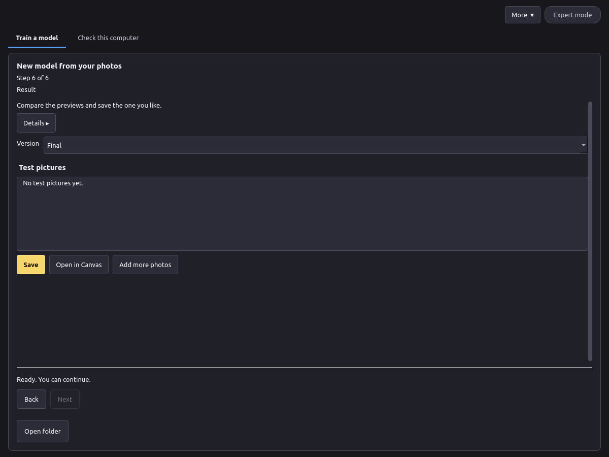

# Export

## Step 6: Result



1. Look at the test pictures and choose a **Version**. A later version is not always better; pick the one you like.
2. **Save** writes one `.safetensors` file with its description file (`voxprint-model.json`), licence and notice. You can keep it or share it under the base model's licence.
3. **Open in Canvas** adds it to your models. In Canvas, choose the LoRA, type the trigger word in your prompt, and set the strength (0.8 is a good start).

To improve a model later, press **Add more photos** on this step. Training continues from the model with the new photos and a share of the old ones.

## Where the files go

- LoRAs sent with **Open in Canvas**: `%LOCALAPPDATA%\VOXPrint AI Suite\models\user-models\lora\<name>\`.
- Projects: `%LOCALAPPDATA%\VOXPrint AI Suite\state\model-forge\lora\`. **More → Open project…** opens an earlier project; **Open folder** shows its photos, versions and test pictures.
- Deleting a project folder removes its photos, descriptions and versions. Saved LoRA files elsewhere are not affected.

## What the model file contains

The names you entered, the trigger word, the consent and 18+ confirmations, how consent was given (verbal or file), the adult-content label, the optional provenance note, whether a release is attached and its fingerprint, and the training settings. It contains no photos, file paths, user name, computer details or photo metadata.

## Command line

The same export is available from the command line:

```text
voxprint-forge-cli lora export --project <project folder> [--checkpoint <step>] [--out <file.safetensors>] [--install-to-mdl]
```

`--install-to-mdl` also adds the LoRA to your models for Canvas. See the [CLI reference](../../cli-reference.md).
