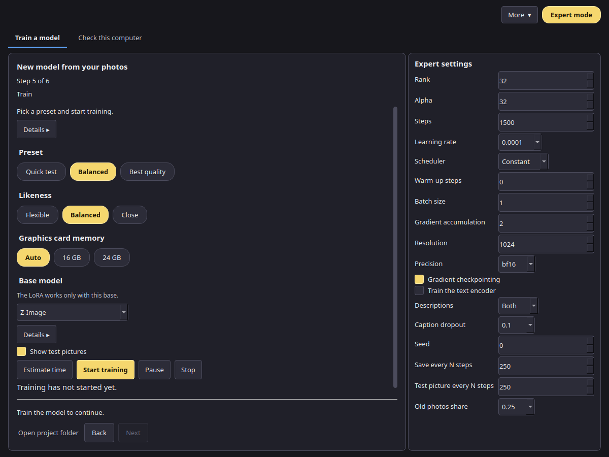

# Model Forge user manual

*Version 0.1 (release candidate). [Русская версия](../ru/index.md).*

Model Forge teaches a picture model something new from your own photos: a person, an object or a style. The result is a small add-on file called a LoRA. You can use it in VOXPrint AI Canvas to make new pictures of that person, object or style.

Everything happens on your computer. Your photos, the descriptions and the trained model are not uploaded anywhere.

## Contents

1. [Install](install.md): requirements, setup and removal.
2. [Model download](models.md): the VOXPrint model downloader (MDL), sources, licences and disk space.
3. [Creating a LoRA project](project.md): photos, names, consent, the 18+ confirmation and the optional release file.
4. [Presets](presets.md): Quick check, Balanced and Best quality, likeness, graphics card tiers and the measured figures.
5. [Training](training.md): checking and preparing photos, settings, progress, pause and stop.
6. [Export](export.md): choosing a version, saving the LoRA and using it in Canvas.
7. [Compression tests](compression.md): how compressed model parts are tested before the app uses them.
8. [Computer memory (RAM) tiers](memory.md): what 32, 64 and 96 GB mean.
9. [Troubleshooting, privacy and licences](troubleshooting.md).

## Simple and Expert mode

- **Simple mode** (the default) guides you through six steps with safe default settings. You choose a preset and the app picks the numbers.
- **Expert mode** (the **Expert mode** button, top right) shows every training setting in a side panel on the right.

The steps are shown at the top of the window. With **Extend the set from samples** off they are Photos, Subject and consent, Check and prepare, Train, Result. **Build a set** is inserted after Subject and consent only while that switch is on, and the counter counts only the steps you can open. Each step shows one short line. On Photos, that line names the subject you chose, and the empty drop area shows a short hint until you add pictures. On the other steps, **Details ▸** opens the full explanation. **Open project folder**, on the same row as Back and Next, opens the folder that holds the photos, versions and test pictures.

The screenshots in this manual use a demo project with neutral placeholder pictures.
