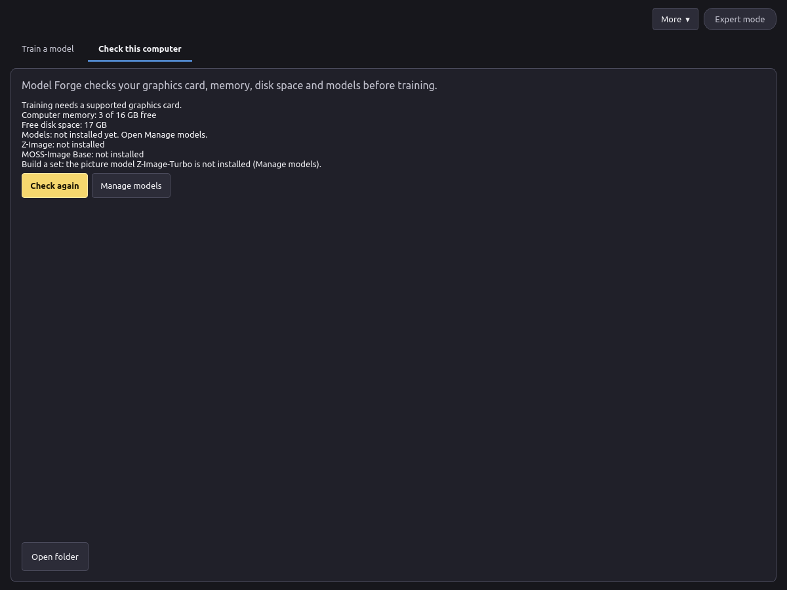

# Install

## Requirements

| | Minimum |
| --- | --- |
| System | Windows 11 24H2 or newer, 64-bit. Linux works from source (see the README). |
| Graphics card | NVIDIA with 16 GB of video memory (24 GB is faster), RTX 30-series or newer |
| Driver | A current NVIDIA driver |
| Computer memory (RAM) | 32 GB. See [RAM tiers](memory.md). |
| Disk | About 45 GB free: about 35 GB for the models, plus the app and your projects. With MOSS-Image Base as well, add about 27 GB. |
| Internet | Needed for the install and the first model download only |
| PowerShell | PowerShell 7 is recommended. If it is missing, the setup offers to download and install it from Microsoft. If you say no, or the install fails, the setup uses Windows PowerShell 5.1 and suggests installing PowerShell 7 later ([how to install](https://learn.microsoft.com/powershell/scripting/install/install-powershell-on-windows)). |

## Install on Windows

1. Run `VoxprintModelForgeSetup.exe` and confirm the administrator prompt.
2. The setup copies the app to `C:\Program Files\VOXPrint AI Suite\Model Forge`, then downloads Python and the libraries it needs. This takes a few minutes. Keep the computer online.
3. When it finishes, open **VOXPrint AI Model Forge** from the Start menu folder **VOXPrint AI Suite**. The setup can also add a desktop shortcut. That choice is off unless you turn it on.

The guide opens from **Open guide** in the app. PDF copies are in `C:\Program Files\VOXPrint AI Suite\Model Forge\docs`.

If the setup fails, it shows the path to its log: `C:\Program Files\VOXPrint AI Suite\Model Forge\setup-work\install.log`. Check the internet connection and run the setup again.

## First launch

Open the **Check this computer** tab. It lists the graphics card, the computer memory, the free disk space and which models are missing. Press **Manage models** to download them (see [Model download](models.md)), then **Check again**.

## Remove the app

Remove the app in Settings > Apps > Installed apps. The Start menu has no Uninstall shortcut. Your projects and downloaded models stay in place. To remove them as well, see [Privacy](troubleshooting.md#privacy).
