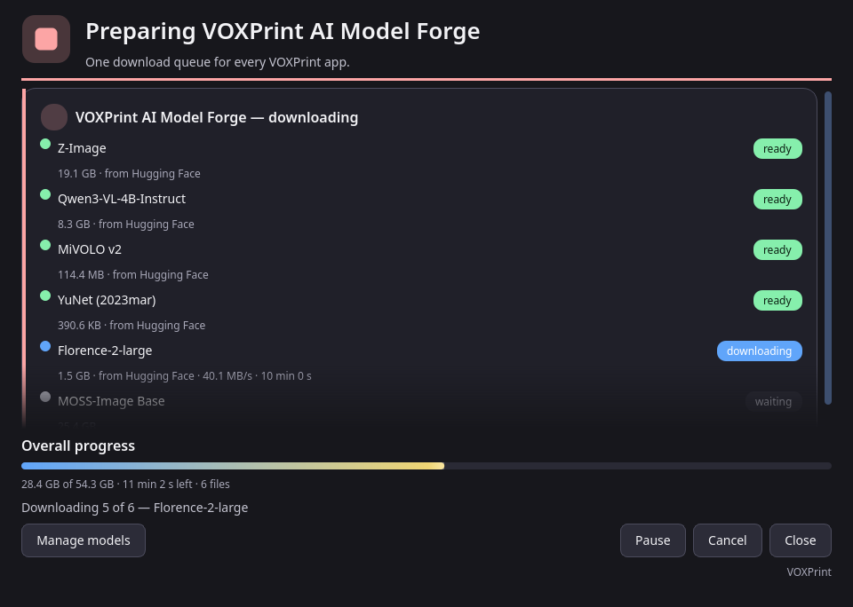

# Model download (MDL)

Model Forge needs some models before it can train. They are not inside the setup, so the setup stays small. On the first launch, open **Check this computer** and press **Manage models**. The VOXPrint model downloader (MDL) opens and downloads what is missing.



| Model | What it does | Source | Licence | Size |
| --- | --- | --- | --- | --- |
| Z-Image (base) | The picture model the LoRA is trained on | Tongyi-MAI/Z-Image | Apache-2.0 | 20.5 GB |
| Qwen3-VL-4B-Instruct | Writes photo descriptions; required for preparing photos | Qwen/Qwen3-VL-4B-Instruct | Apache-2.0 | 8.9 GB |
| MiVOLO v2 | Required for preparing photos | iitolstykh/mivolo_v2 | Apache-2.0 | 0.1 GB |
| YuNet (2023mar) | Finds faces; required for preparing photos | opencv/opencv_zoo | MIT | under 1 MB |
| Florence-2-large | Backup description writer | microsoft/Florence-2-large | MIT | 1.6 GB |
| MOSS-Image Base | A second base model. Faster, and fits a 16 GB card | OpenMOSS-Team/MOSS-Image-Base | Apache-2.0 | 27.2 GB |
| Z-Image-Turbo | Draws the pictures in **Build a set** (optional) | Tongyi-MAI/Z-Image-Turbo | Apache-2.0 | 32.9 GB |
| DINOv2 base | Marks near-duplicate pictures in **Build a set** (optional) | facebook/dinov2-base | Apache-2.0 | 0.4 GB |

- **Sources.** Every model is downloaded from its author's official page, at a fixed version. The downloader checks each file against its published checksum before it is used.
- **Licences.** Each model keeps its own licence. Read it in Manage models before you use the model. Your LoRA inherits the licence of the base model it was trained on.
- **Disk.** Models go to the shared VOXPrint models folder, by default `%LOCALAPPDATA%\VOXPrint AI Suite\models`. Other VOXPrint apps use the same folder, so a model is downloaded only once.
- **Background and resume.** Downloads continue in the background if you close the downloader window, and they resume after an interruption. **Pause** and **Cancel** are at the bottom of the window.

## Check and repair

**Check this computer** has **Check and repair models**. The progress window opens every time, including when every file is already in place. Each installed model is checked file by file: the file must be present and its checksum must match. The model is then **OK**, **missing**, or **corrupt**. **Repair** downloads only the missing or damaged files from the official source, checks the pinned checksum, and continues a partial download when the source allows it. LoRAs and projects stay as they are. A plug-in model from an official source is repaired from that source address in the same way.

```text
voxprint-forge-cli models verify
voxprint-forge-cli models verify --repair
voxprint-forge-cli models verify --gui
```

`models verify` prints a table and exits with an error when anything is still broken. `--repair` fixes the files without asking. `--gui` opens the progress window.

To remove a model you no longer need, open **Manage models** again: it lists installed models with their size and licence.
