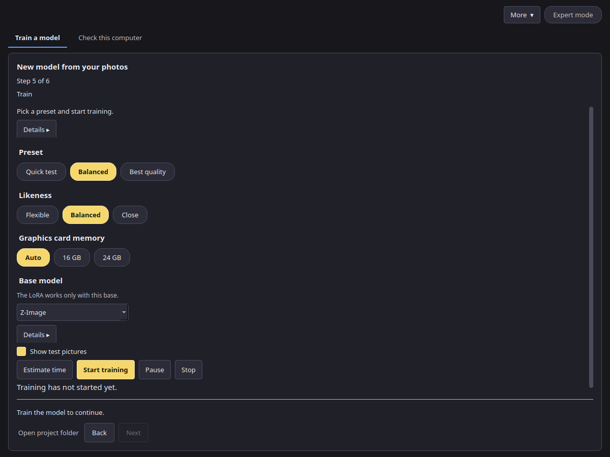

# Presets

On the **Train** step you choose a preset, a likeness and the graphics card memory. The app turns them into the training numbers. In Expert mode every number can be changed in the Expert panel.

## Preset

| Preset | Steps | LoRA rank | Learning rate | Picture size | Use it for |
| --- | --- | --- | --- | --- | --- |
| **Quick check** | 150 | 16 | 0.0001 | 768 px | A smoke test of the whole path: prepare, train, samples, finish and export. Not for a usable person LoRA |
| **Balanced** (recommended) | 1600 | 64 | 0.0001 | 1024 px | Most projects, and every person LoRA |
| **Best quality** | 3000 | 64 | 0.00008 | 1024 px | The final model, when time is not a concern |

**For a person, use Balanced** (`--preset balanced` on the command line, the default). Quick check only shows that your setup works. On an RTX 4090 person run, 120 Quick check steps scored 1.68 out of 5 for likeness, and 1000 Balanced steps scored 3.95 out of 5.

## Likeness

Likeness changes the number of steps and how often a description is left out during training.

| Likeness | Steps | Use it when |
| --- | --- | --- |
| **Flexible** | 0.7 × the preset | The subject should be easy to put in new scenes |
| **Balanced** | as the preset | Most projects |
| **Close** | 1.3 × the preset | The pictures should look more like your photos |

## Graphics card memory: 16 GB and 24 GB

**Auto** reads your card: under 20 GB is the 16 GB tier, otherwise the 24 GB tier. You can also pick **16 GB** or **24 GB** yourself.

- Both tiers train one picture at a time with gradient checkpointing on. Balanced and Best quality add two pictures up before each step; Quick check does one.
- **Z-Image**, 16 GB tier: the base model is stored in a compact 8-bit form to fit the card. 24 GB tier: full precision.

## Measured figures

These come from a calibration run of the Balanced preset (1024 px, rank 64, one picture and two accumulations per step) on an RTX 4090, with its memory limited to 16 GB or 22.5 GB to stand in for each card.

| Base model | Tier | Text encoder | Time per step | Planned peak | Reserved peak |
| --- | --- | --- | --- | --- | --- |
| Z-Image | 16 GB | full precision | 9.7 s at 1024 px, batch 1, accum 1, measured | 9.03 GiB (`quick`), 10.73 GiB (`balanced`/`best`) | not measured |
| Z-Image | 24 GB | full precision | 1.6 s at 1024 px, not measured | 14.87 GiB (`quick`), 16.93 GiB (`balanced`/`best`) | not measured |

The Z-Image 16 GB time was measured on a 16 GB RTX 4090 laptop, one picture at 1024 px, batch 1, accum 1. That run did not record a peak. `balanced` and `best` use accum 2, so Estimate time scales the 9.7 s figure to 19.4 s per optimizer step; `quick` at 768 px scales it to about 5.46 s. Planned peaks are from the Z-Image memory plan (no GPU), not from a memprobe. The 24 GB Z-Image time has not been measured. The Train step lists Z-Image as the default base; Z-Image-Turbo is an Expert alternative that trains with a frozen adapter.
