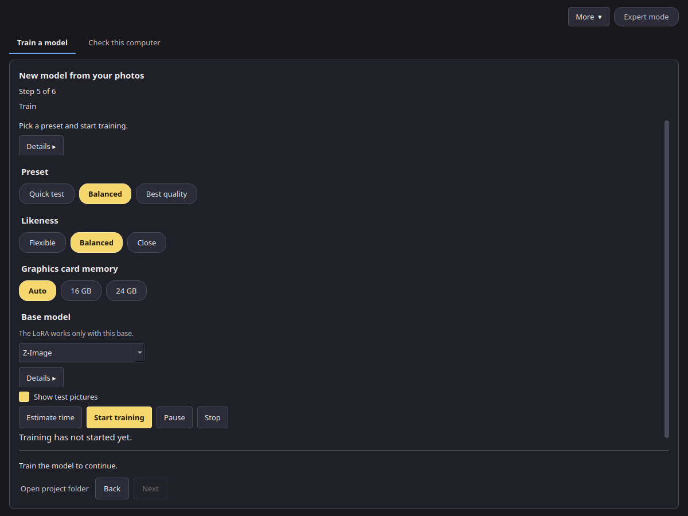

# Presets

On the **Train** step you choose a preset, a likeness and the graphics card memory. The app turns them into the training numbers. In Expert mode every number can be changed in the Expert panel.

## Preset

| Preset | Steps | LoRA rank | Learning rate | Picture size | Use it for |
| --- | --- | --- | --- | --- | --- |
| **Quick check** | 150 | 16 | 0.0001 | 768 px | A short run of the whole path: prepare, train, samples, finish and export |
| **Balanced** (recommended) | 1500 | 32 | 0.0001 | 1024 px | Most projects |
| **Best quality** | 3000 | 32 | 0.00008 | 1024 px | The final model, when time is not a concern |

## Likeness

Likeness changes the number of steps and how often a description is left out during training.

| Likeness | Steps | Use it when |
| --- | --- | --- |
| **Flexible** | 0.7 × the preset | The subject should be easy to put in new scenes |
| **Balanced** | as the preset | Most projects |
| **Close** | 1.3 × the preset | The pictures should look more like your photos |

## Graphics card memory: 16 GB and 24 GB

**Auto** reads your card: under 20 GB is the 16 GB tier, otherwise the 24 GB tier. You can also pick **16 GB** or **24 GB** yourself.

- Both tiers train one picture at a time with gradient checkpointing on. Balanced and Best quality add two pictures up before each step; Quick check does one.
- **Z-Image**, 16 GB tier: the base model is stored in a compact 8-bit form to fit the card. 24 GB tier: full precision.
- **MOSS-Image Base**: on the 16 GB tier the picture model is stored as FP8 e4m3 weights (bf16 compute) so it fits the card. On the 24 GB tier it stays in full precision. Its text encoder runs on the graphics card, compressed to 8 bits on the 16 GB tier and in full precision on the 24 GB tier (see [Compression tests](compression.md)).

## Measured figures

These come from a calibration run of the Balanced preset (1024 px, rank 32, one picture and two accumulations per step) on an RTX 4090, with its memory limited to 16 GB or 22.5 GB to stand in for each card.

| Base model | Tier | Text encoder | Time per step | Peak video memory |
| --- | --- | --- | --- | --- |
| MOSS-Image Base | 16 GB | 8-bit, on the card | 4.89 s | 13.6 GB |
| MOSS-Image Base | 24 GB | full precision, on the card | 4.90 s | 18.5 GB |
| Z-Image | 16 GB | full precision | 9.7 s at 1024 px | not measured |
| Z-Image | 24 GB | full precision | 1.6 s at 1024 px, not measured | not measured |

The Z-Image 16 GB time was measured on a 16 GB RTX 4090 laptop, one picture at 1024 px. That run did not record a peak, so the card line stays 16 GB+. The 24 GB Z-Image time has not been measured. **Estimate time** and the first-pictures line use these seconds per step. A Balanced run on MOSS-Image Base (1500 steps) takes about 2 hours of training on such a card, plus a few minutes to load. The base model list on the Train step shows the measured peak for MOSS-Image Base; for Z-Image it shows the smallest card the presets target (16 GB+).
