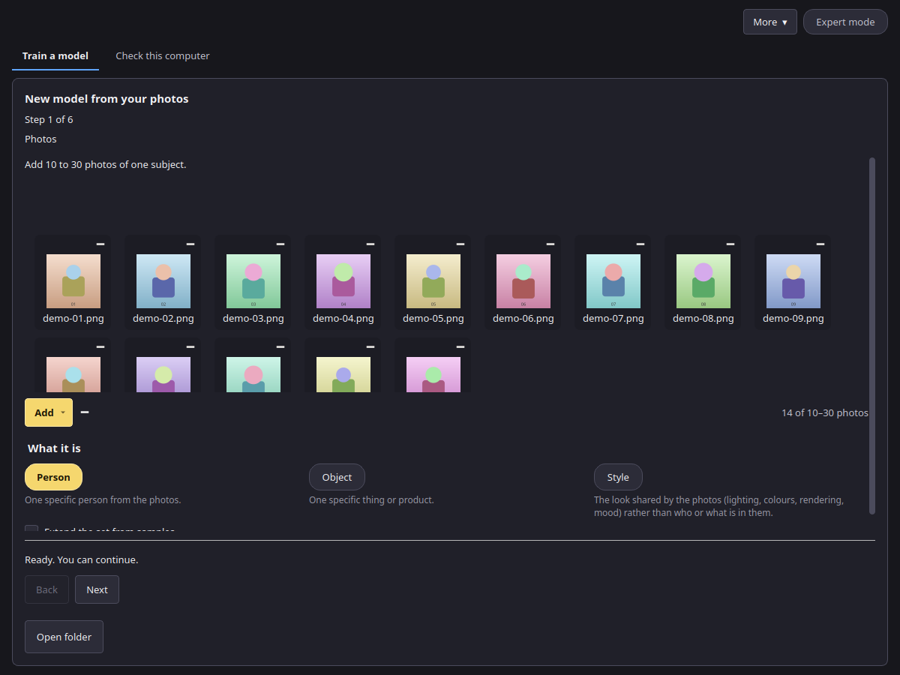
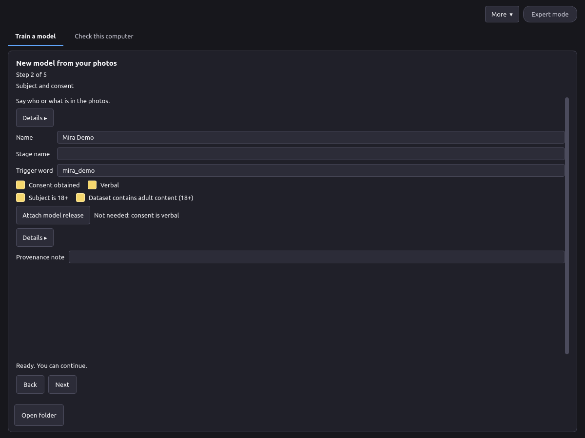
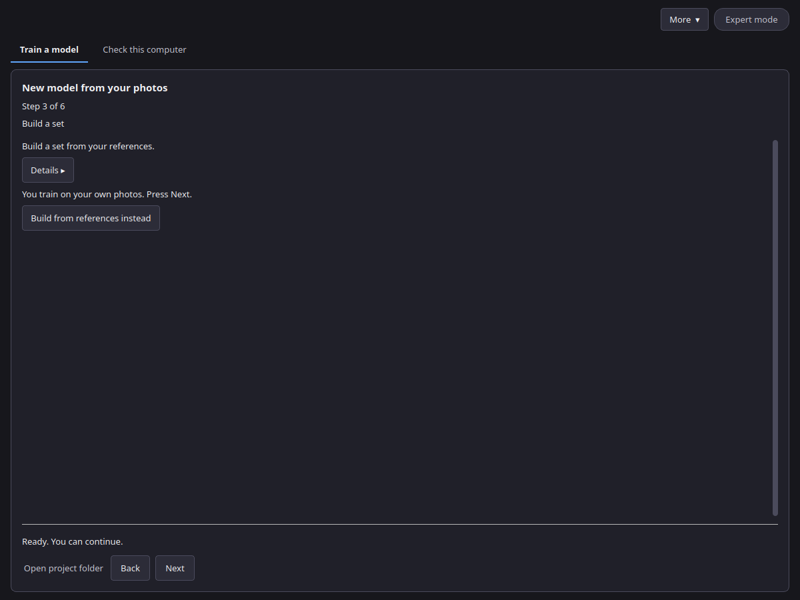

# Creating a LoRA project

Start with **More → New model**. A project keeps your photos, their descriptions, the training versions and the test pictures in one folder.

## Step 1: Photos

1. Choose what the photos show: **Person** (one specific person), **Object** (one specific thing or product) or **Style** (the shared look: lighting, colours, rendering, mood). The line above follows that choice.
2. Press **Add** and choose **Add photos** or **Add a folder** (JPG, PNG, WebP or AVIF), or drop photos or a folder into the dashed area. Until the list has pictures, that area shows a short hint: sharp photos, different angles, light and backgrounds, no near-duplicates or group shots, and that 15 to 20 good photos are usually enough.
3. Leave **Extend the set from samples** off to train on these photos. Turn it on and, during training, the app shows new pictures. You mark the ones that work, and they join the set. The count line switches to a range of 1 to 10 photos (see below). Training pauses after each stage for those marks (see [Training](training.md)).

Good photos make a good model:

- 15 to 20 sharp photos are usually enough. Recommended: 10 to 30 photos. Allowed in Expert: 5 to 60 photos.
- Vary the angle, light, background and clothing.
- One subject per photo. Avoid group shots, heavy filters and near-duplicates.
- For a style, use pictures that share the style but show different things.

## Step 2: Subject and consent

- **Name** or **Stage name**: enter one of them; one is enough. The **Trigger word** is the word you will later type in Canvas to call the model. The app suggests a rare token (`vxp` and consonants), not a word from the name. A stage name is only an alias. You can change the trigger word. An ordinary word can make the model draw that word as text.
- **Consent obtained** (for a person): tick it when the person agreed to this use. Then either tick **Verbal**, right next to it, if consent was given in words, or press **Attach model release** to add a release file. With **Verbal** no file is needed.
- **Release file** (optional): an attached release stays in your project folder. Only a note that it exists and its fingerprint go into the model file.
- **Subject is 18+**: tick it to confirm that the person is an adult. A person project cannot continue without it.
- **Dataset contains adult content (18+)**: appears next to **Subject is 18+** once that box is ticked. It is off by default. Tick it if the photos contain adult content; apps such as Canvas use this label to sort and filter models.
- **Subject attribute** (optional): leave it empty unless you need it. The tooltip shows which values it accepts.
- **Object** or **Style**: confirm that you have the right to use these photos. A style must not be presented as the work of a named living artist.
- **Provenance note** (optional): where the photos come from.

Every photo must show consenting adults, and you must have the right to use it. Some photos may be refused during preparation; replace them with other photos of the same subject.

## Step 3: Build a set (optional)

With your own photos this step only says so; press **Next**. Have only a few good pictures? Turn on **Extend the set from samples** on step 1, or press **Build from references instead** here, and use 1 to 10 photos of one person, one thing or one style. Then:

1. Press **Make pictures**. The app draws a round of new pictures from your references with Z-Image-Turbo.
2. Tick each picture that looks right (or click it). Unticked pictures are not used.
3. Press **Next round** to draw again from the kept pictures and your references. Repeat until the set looks right.
4. Press **This is it**. The references and the kept pictures become the training set.

Simple mode draws 24 pictures per round. Expert mode shows **Pictures per round**, **Variation strength** and **Steps** in the Expert panel. Pictures marked **≈ very similar to another** look almost the same as another one; keep only one of them. Some pictures may be refused and are not shown. **Start over** forgets the rounds and keeps the references.

Next: [Presets](presets.md) and [Training](training.md).
