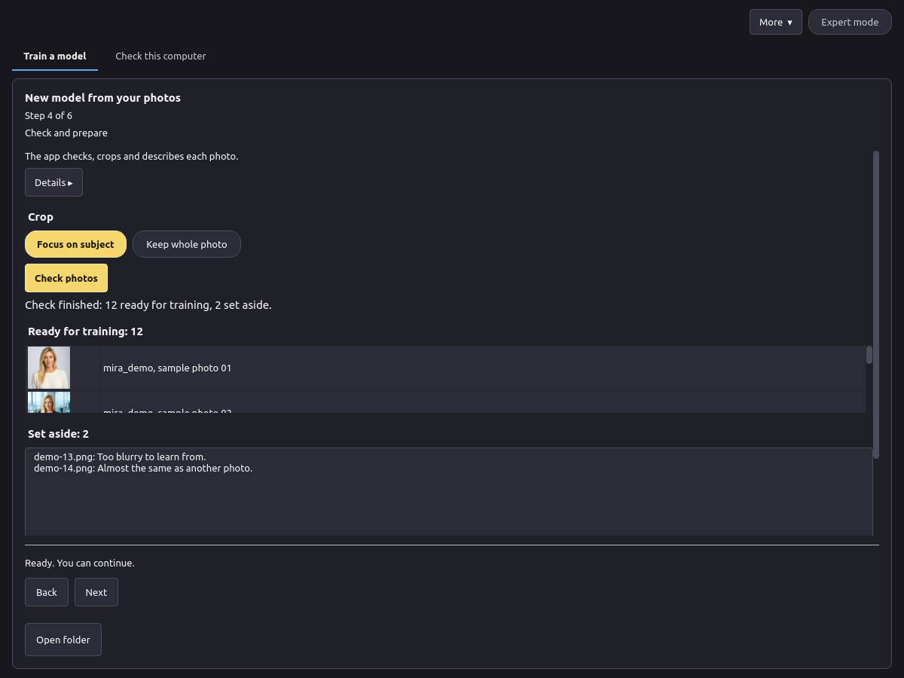
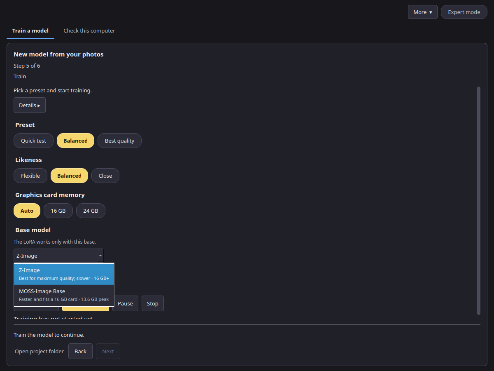
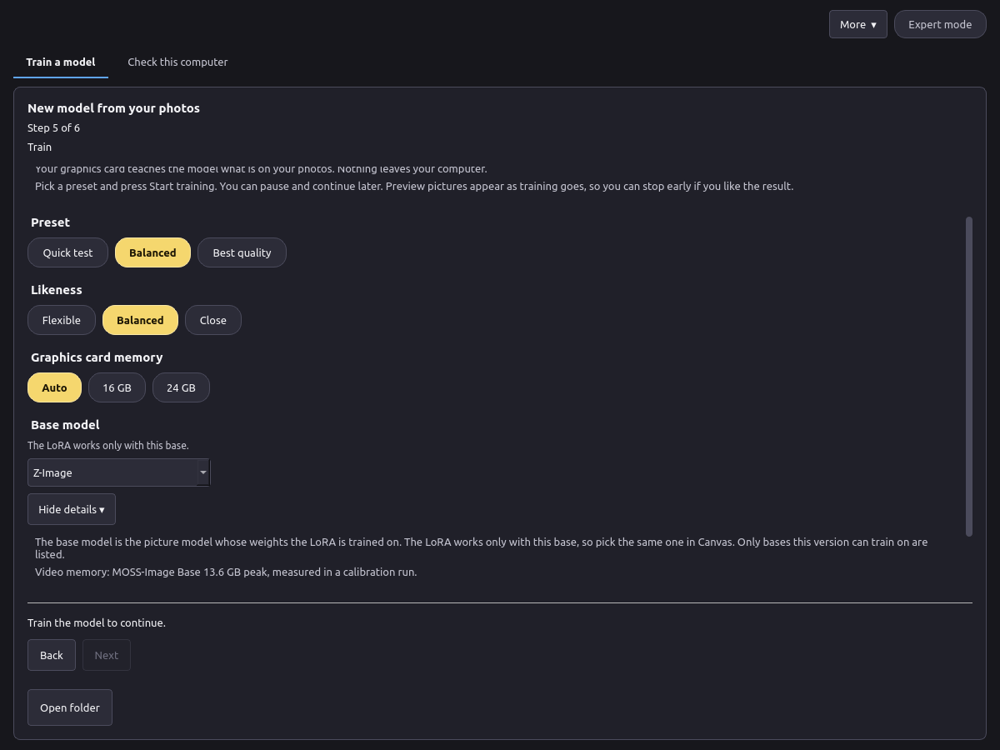
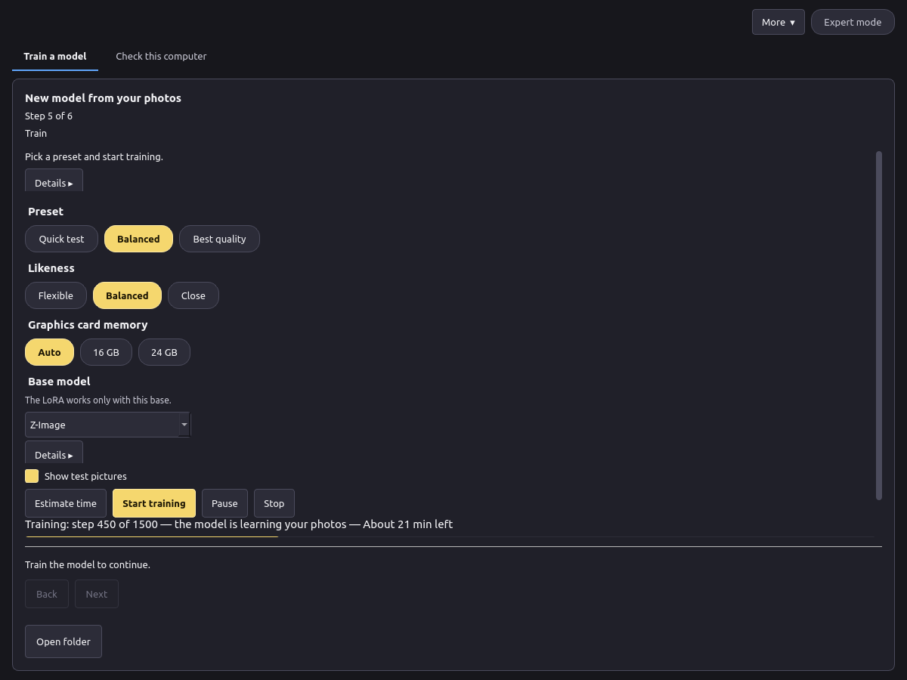
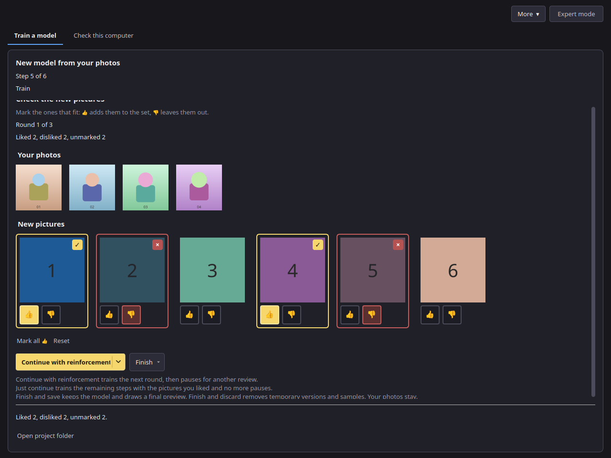
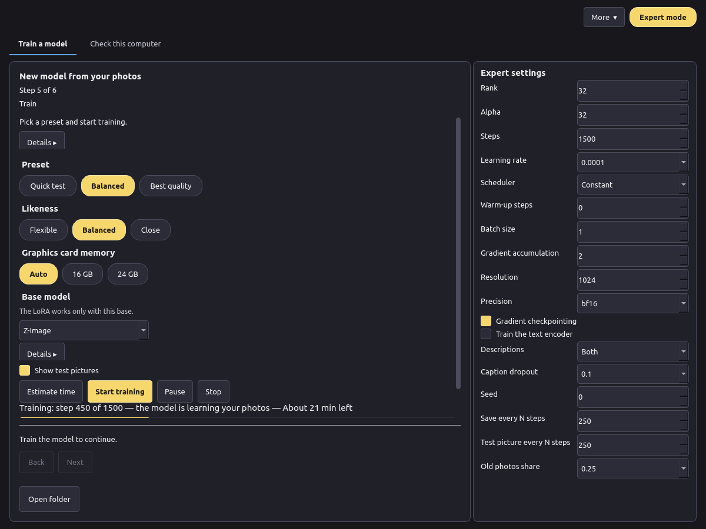

# Training

## Step 4: Check and prepare

1. Choose the crop: **Focus on subject** or **Keep whole photo**.
2. Press **Check photos**. The app checks each photo, crops it and writes a short description of it. The trigger word is added to every description, so the model links the word to your subject.
3. Read the list. **Ready for training** shows the photos that will be used with their descriptions. **Set aside** lists the photos that will not be used, each with a reason (for example, too blurry or almost the same as another photo).

You can remove any photo before training. If too few photos are left, add more on step 1.

## Step 5: Train

Choose a preset, a likeness and the graphics card memory (see [Presets](presets.md)), and the base model:

- **Base model** is the picture model the LoRA is trained on. The LoRA works only with this base, so pick the same one in Canvas. **Z-Image** is best for maximum quality and is slower. **MOSS-Image Base** is faster and fits a 16 GB card. The second line of each option shows what it is best for and its video memory.

  

- **Details ▸** under each setting explains it. The base model details include the measured video memory.

  

- **Show test pictures** is a switch. While it is on, the app draws a few pictures during training so you can see progress. Those pictures are separate from the ones you mark between rounds.

**Details ▸** on this step, when review rounds are on, holds **Review rounds** (1 to 6, default 3) and **First-round steps** (100 to 500, default 120). Review rounds is how many times training pauses. First-round steps is the length of the stage before the first review. While a stage is running, **Estimate time** is greyed out, the same as **Start training**.

Press **Estimate time** for a forecast, then **Start training**. While a stage is running, the step says that training is running, and the preset, likeness, memory and base model stay locked. **Start training** and **Estimate time** are greyed out. A line shows the step out of the total, how long the stage has been running and the time left, in hours and minutes. During the first round the same line says when the first pictures will be ready: steps still to run times the measured seconds per step, plus the pictures still to draw times the seconds per picture. Until one picture has been timed, each denoising step is estimated as half a training step. Once a picture has been timed, the line also shows the seconds per picture. The bar under that line ends with the percent. The loss is under **Details**. **Pause** and **Stop** stay available. **Stop** asks before it ends the run.

- **Pause** saves a version and stops. Press **Continue** later to go on from that version.
- **Stop** asks, then ends the run. The versions saved so far are kept.
- The app saves a version six times during a run, so you can compare them on the next step.

## Review rounds

With **Extend the set from samples** on (Photos step), training pauses for review. **Review rounds** (1 to 6, default 3) is how many pauses are planned. The first stage is **First-round steps** (default 120, from 100 to 500). The app then draws 6 pictures at the training resolution, 28 inference steps each. Later rounds draw 8 pictures, also at 28 steps. The preset steps that remain (the preset total minus the first-round steps) are split evenly across the remaining planned rounds, and the last of those rounds takes the remainder. The preset total does not change. A single planned round is only the first-round length; the steps still left are what **Just continue** runs.

The heading is **Check the new pictures**. Your photos stay beside the new pictures. Each new picture has **Include** and **Leave out**. A picture you include gets a gold border and a check. A picture you leave out is dimmed, with a red border and a cross. A picture with no mark stays plain.

**Mark all 👍** includes every new picture. **Reset** clears the marks. The footer counts pictures you included, pictures you left out, and pictures with no mark. The primary button is split. **Continue with reinforcement** trains the next round, then pauses for another review. Its menu item **Just continue** keeps the pictures you liked and trains the remaining steps with no more pauses. **Finish** opens a small menu. **Finish and save** asks first and shows the steps done out of the plan, then saves the model and draws a final preview. The result is a finished LoRA you can export, labelled with the steps it got (for example, finished at 450 of 1500 steps) on the result screen, in `train.json`, and in the export (`steps` and `steps_planned`). **Finish and discard** asks first, then stops and removes the project's temporary versions and samples. Nothing is saved. Your photos stay. If any picture has no mark, **Continue with reinforcement** and **Just continue** ask you to confirm: unmarked pictures will not join the set. A short note under the buttons explains the actions. You can finish before the last planned round. Back and Next stay hidden. Closing the app does not drop a paused review: open the project again and the same screen is there.

On the command line, `lora train --review-rounds N --first-round-steps 120 --first-round-samples 6 --samples-per-round 8 --sample-steps 28` pauses the same way. N is from 1 to 6, and the default is 3. `lora review` lists the pictures and sets marks (`--like`, `--dislike`, or `--from-file`). `lora continue PROJECT` trains the next round, then pauses for another review. `lora continue PROJECT --unattended` trains the remaining steps with no more pauses. `lora finish PROJECT` saves the model, draws a final preview, and records the steps it got. `lora finish PROJECT --discard` stops and removes temporary versions and samples; without a terminal it also needs `--yes`. Your photos stay. `lora status` prints the same first-pictures line during round 1. `--review-rounds 0` trains straight through.

## Expert settings

In Expert mode the panel on the right shows every value: Rank, Alpha, Steps, Learning rate, Scheduler, Warm-up steps, Batch size, Gradient accumulation, Resolution, Precision, Gradient checkpointing, Train the text encoder, Descriptions, Description model, Caption dropout, Seed, Save every N steps and Test picture every N steps. The reset button next to the presets puts back the values of the chosen preset.

Recommended: 10 to 30 photos. Allowed in Expert: 5 to 60 photos.
