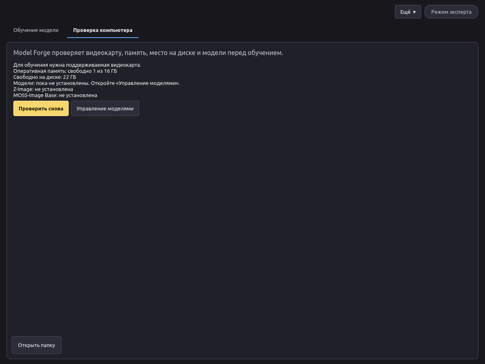
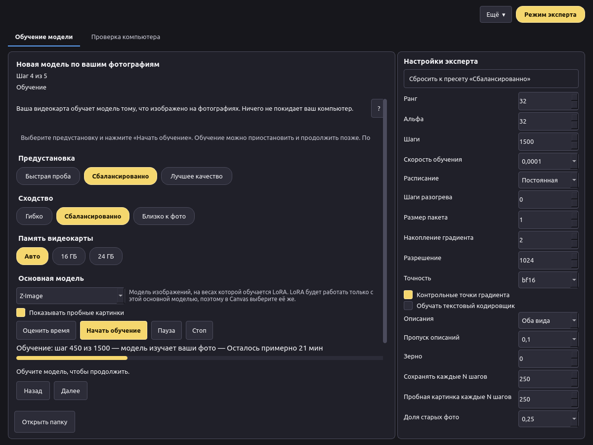
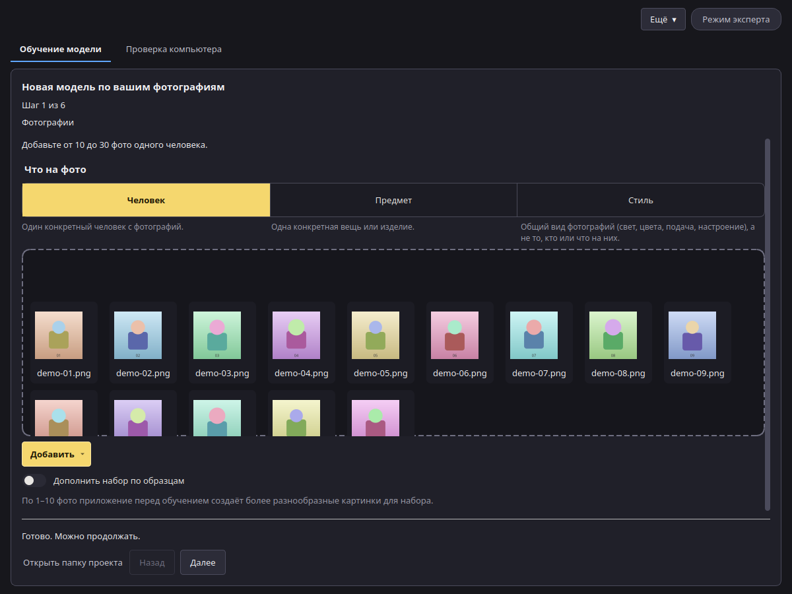
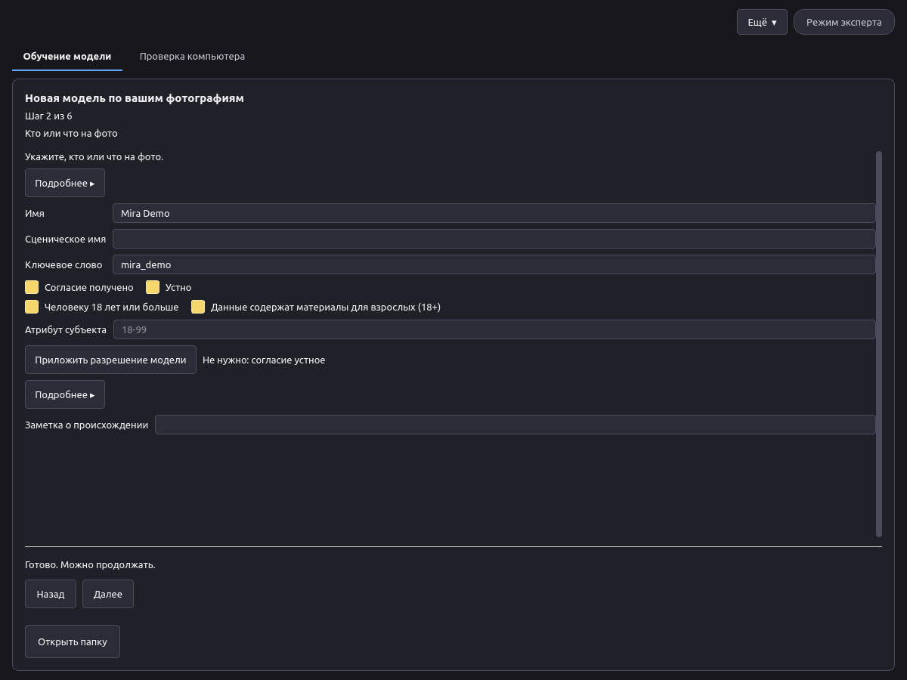
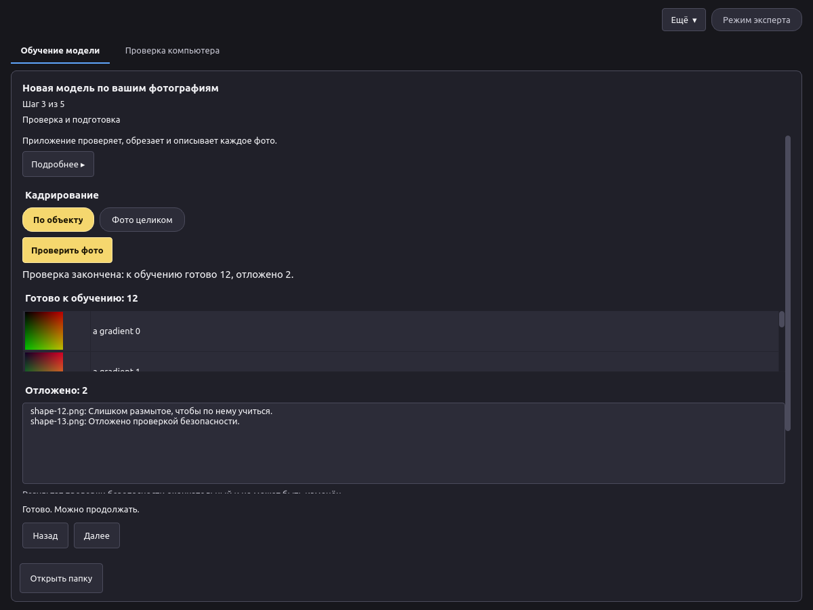
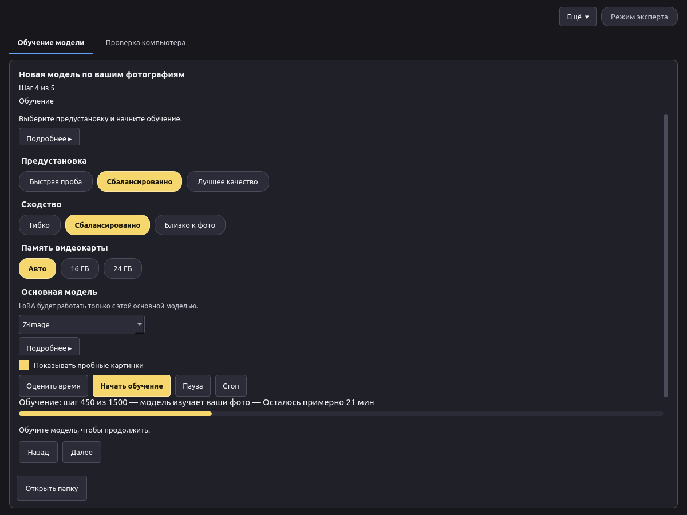
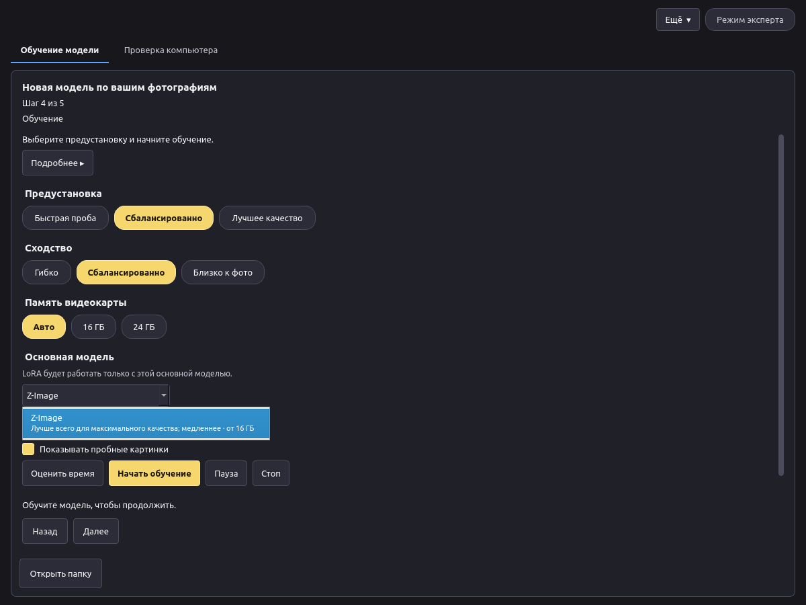
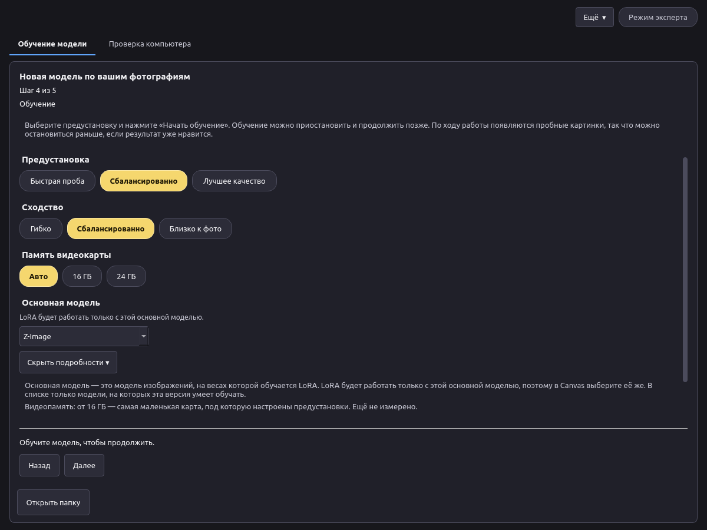
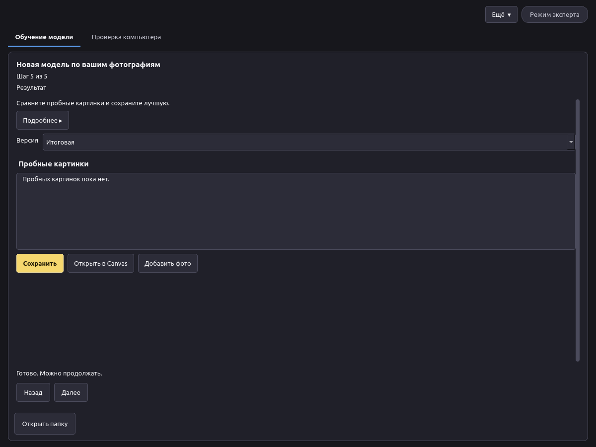

# VOXPrint AI Model Forge: руководство пользователя

*Версия 0.1. [English version](en.md).*

Картинки с пометкой **Место для снимка экрана** будут добавлены позже.

## 1. Что такое Model Forge

Model Forge учит модель для картинок чему-то новому по вашим фотографиям: человеку, предмету или стилю. Результат — небольшой файл-дополнение, LoRA. Его можно использовать в VOXPrint AI Canvas, чтобы создавать новые картинки с этим человеком, предметом или в этом стиле.

Всё происходит на вашем компьютере. Фотографии, описания и обученная модель никуда не отправляются.

В Model Forge есть и другие инструменты для опытных пользователей (преобразование моделей, замеры). Это руководство посвящено обучению LoRA.

## 2. Требования и установка

**Требования**

| | Минимум |
| --- | --- |
| Система | Windows 11 24H2 или новее, 64-разрядная. На Linux приложение запускается из исходного кода (см. README). |
| Видеокарта | NVIDIA с 16 ГБ видеопамяти (с 24 ГБ быстрее), серия RTX 30 или новее |
| Драйвер | Актуальный драйвер NVIDIA |
| Диск | Около 45 ГБ свободного места: около 35 ГБ на модели, плюс приложение и ваши проекты |
| Интернет | Нужен только для установки и первой загрузки моделей |

Данные о памяти и времени будут уточнены после итоговых испытаний на видеокарте.

**Установка в Windows**

1. Запустите `VoxprintModelForgeSetup.exe` и подтвердите запрос администратора.
2. Установщик копирует приложение в `C:\Program Files\VOXPrint AI Suite\Model Forge`, затем загружает Python и нужные библиотеки. Это занимает несколько минут. Не отключайте интернет.
3. После завершения откройте **VOXPrint AI Model Forge** из папки **VOXPrint AI Suite** в меню «Пуск».

Если установка не удалась, установщик покажет путь к журналу: `C:\Program Files\VOXPrint AI Suite\Model Forge\setup-work\install.log`.

> **Место для снимка экрана:** окно установщика во время установки.

Чтобы удалить приложение, используйте **Uninstall VOXPrint AI Model Forge** в той же папке меню «Пуск» или параметры Windows. Ваши проекты и загруженные модели остаются на месте (см. раздел 7).

## 3. Первый запуск: загрузка моделей, источники, лицензии, диск

Для обучения Model Forge нужны модели. Их нет внутри установщика, поэтому он небольшой. При первом запуске откройте вкладку **Проверка компьютера** и нажмите **Управление моделями**. Откроется загрузчик моделей VOXPrint (MDL) со списком недостающего.

| Модель | Что делает | Источник | Лицензия | Размер |
| --- | --- | --- | --- | --- |
| Z-Image (base) | Модель для картинок, на которой обучается LoRA | Tongyi-MAI/Z-Image | Apache-2.0 | 20,5 ГБ |
| Qwen3-VL-4B-Instruct | Пишет описания фото и проверяет каждое фото | Qwen/Qwen3-VL-4B-Instruct | Apache-2.0 | 8,9 ГБ |
| MiVOLO v2 | Проверка безопасности | iitolstykh/mivolo_v2 | Apache-2.0 | 0,1 ГБ |
| YuNet (2023mar) | Находит лица (проверка безопасности) | opencv/opencv_zoo | MIT | меньше 1 МБ |
| Florence-2-large | Запасной автор описаний | microsoft/Florence-2-large | MIT | 3,1 ГБ |
| MOSS-Image Base | Вторая основная модель (необязательная, появится позже) | OpenMOSS-Team/MOSS-Image-Base | Apache-2.0 | 27,2 ГБ |

- **Источники.** Каждая модель загружается с официальной страницы автора, в закреплённой версии. Перед использованием загрузчик сверяет каждый файл с опубликованной контрольной суммой.
- **Лицензии.** У каждой модели своя лицензия. Прочитайте её в «Управлении моделями» до начала работы. Ваша LoRA наследует лицензию основной модели, на которой обучена.
- **Диск.** Модели сохраняются в общую папку моделей VOXPrint, по умолчанию `%LOCALAPPDATA%\VOXPrint AI Suite\models`. Другие приложения VOXPrint используют ту же папку, поэтому каждая модель загружается один раз. Если закрыть окно загрузчика, загрузка продолжится в фоне, а после обрыва связи возобновится.

> **Место для снимка экрана:** «Управление моделями» с моделями Model Forge.

## 4. Простой режим и режим эксперта

- **Простой режим** (по умолчанию) ведёт вас через шесть шагов с безопасными настройками. Вы выбираете предустановку, а числа подбирает приложение.
- **Режим эксперта** (кнопка **Режим эксперта** справа вверху) показывает все настройки обучения на боковой панели. Рекомендуется от 10 до 30 фото. Допустимо в режиме эксперта: от 5 до 60 фото.

Проверка безопасности (раздел 5.3) работает одинаково в обоих режимах. В режиме эксперта нет настроек безопасности.

## 5. Обучение LoRA: человек, предмет, стиль

Начните с **Ещё → Новая модель**. Шаги показаны вверху окна (Шаг 1 из 6 … Шаг 6 из 6): 1 Фотографии, 2 Объект и согласие, 3 Сбор набора, 4 Проверка и подготовка, 5 Обучение, 6 Результат. Шаг 3 нужен, только если набор собирается по образцам (раздел 5.7); со своими фотографиями он проходится сам. На каждом шаге видна одна короткая строка. **Подробнее ▸** под ней открывает полное пояснение; по умолчанию оно свёрнуто. У выбора субъекта и основной модели есть свои **Подробнее ▸**.

### 5.1 Фотографии

1. Нажмите **Добавить фото** или **Добавить папку** (JPG, PNG или WebP) либо перетащите фото в окно.
2. Укажите, что на фото: **Человек**, **Предмет** или **Стиль**.

Хорошие фото — хорошая модель:

- Обычно хватает 15–20 чётких фото (рекомендуется от 10 до 30 фото).
- Меняйте ракурс, освещение, фон и одежду.
- Один объект на фото. Избегайте групповых снимков, сильных фильтров и почти одинаковых кадров.
- Для стиля берите картинки в одном стиле, но с разным содержанием.

### 5.2 Согласие, права и 18+

Введите **Имя** или **Сценическое имя** (достаточно одного). **Ключевое слово** — это слово, которое вы потом напишете в Canvas, чтобы вызвать модель; приложение предложит его само.

- **Человек:** отметьте **Согласие получено** (человек согласился на такое использование). Затем либо отметьте **Устно** рядом с ним, если согласие дано на словах, либо приложите разрешение модели. С отметкой **Устно** файл не нужен; в файле модели согласие записывается как устное. Приложенное разрешение остаётся в вашем проекте; в файл модели попадают только отметка о том, что оно есть, и его отпечаток. Также отметьте **Человеку 18 лет или больше**.
- **Данные содержат материалы для взрослых (18+):** появляется справа от **Человеку 18 лет или больше**, когда этот пункт отмечен. По умолчанию выключено. Отметьте, если на фото есть материалы для взрослых; приложения, например Canvas, используют эту пометку для сортировки и фильтрации моделей. Если снять отметку 18+, эта отметка тоже снимается.
- **Предмет** или **Стиль:** подтвердите, что у вас есть право использовать эти фото. Стиль нельзя выдавать за работу конкретного ныне живущего художника.
- **Заметка о происхождении** (необязательно): откуда эти фото.

Обучайте модель только на людях, которые на это согласились, и только на фото, которые вы вправе использовать.

### 5.3 Проверка безопасности и почему фото откладываются

Model Forge никогда не обучается на несовершеннолетних. Перед обучением каждое фото проходит проверку безопасности.
Для набора с человеком на шаге 2 нужны подтверждения 18+ и согласия. Некоторые фото могут быть отложены с причиной
«Отложено проверкой безопасности»; замените их другими фото того же человека. В редких случаях весь проект
**блокируется**. Если модели проверки не установлены, подготовка не начинается. Проверка включена всегда и не
отключается.

### 5.4 Описания и ключевое слово

Нажмите **Проверить фото**. Приложение проверяет каждое фото, обрезает его (**По объекту** или **Фото целиком**) и пишет к нему короткое описание. Ключевое слово добавляется в каждое описание, чтобы модель связала его с вашим объектом.

Перед обучением можно посмотреть обрезанные фото, описания и причины, по которым фото отложены, и убрать любое фото.

### 5.5 Настройки и ход обучения

- **Предустановка:** **Быстрая проба** (быстрый первый взгляд), **Сбалансированно** (рекомендуется) или **Лучшее качество** (медленнее).
- **Сходство:** **Гибко** (проще помещать в новые сцены), **Сбалансированно** или **Близко к фото** (больше похоже на фото).
- **Память видеокарты:** **Авто**, **16 ГБ** или **24 ГБ**. «Авто» определяет вашу видеокарту.
- **Основная модель:** модель изображений, на весах которой обучается LoRA. LoRA будет работать только с этой основной моделью, поэтому в Canvas выберите её же. В списке только те модели, на которых эта версия умеет обучать; сейчас это **Z-Image** (лучше всего для максимального качества; медленнее; от 16 ГБ). Список открывается под полем. Вторая строка каждого варианта говорит, для чего модель подходит лучше всего и сколько видеопамяти нужно. Подробности — во всплывающей подсказке и в **Подробнее ▸**. «От 16 ГБ» — самая маленькая видеокарта, под которую настроены предустановки; после калибровки здесь появятся измеренные цифры.

  

  
- **Показывать пробные картинки:** во время обучения рисуется несколько картинок, чтобы был виден результат.

Нажмите **Оценить время**, чтобы увидеть прогноз, затем **Начать обучение**. Полоса показывает шаг, что сейчас происходит и сколько осталось (после первых шагов).

- **Пауза** сохраняет версию и останавливает обучение. Позже нажмите **Начать обучение**, чтобы продолжить с этой версии.
- **Стоп** завершает обучение. Уже сохранённые версии остаются.

### 5.6 Результат и использование в Canvas

1. Посмотрите пробные картинки и выберите **Версию**. Поздняя версия не всегда лучше; берите ту, что нравится.
2. **Сохранить** записывает один файл `.safetensors` с файлом описания (`voxprint-model.json`), лицензией и уведомлением. Его можно хранить или передавать на условиях лицензии основной модели.
3. **Открыть в Canvas** добавляет его к вашим моделям. В Canvas выберите LoRA, напишите ключевое слово в запросе и задайте силу (для начала подойдёт 0,8).

> **Место для снимка экрана:** LoRA в Canvas с ползунком силы.

Чтобы улучшить модель позже, нажмите **Добавить фото** на этом шаге. Обучение продолжится с этой модели на новых фото и части старых.

### 5.7 Сбор набора по образцам

Если хороших снимков мало, Model Forge поможет собрать набор для обучения.

1. На шаге 1 в пункте **Из чего учить** выберите **Собрать набор по образцам** и добавьте от 1 до 10 образцов одного объекта.
2. Заполните шаг 2 как обычно: имена, **Согласие получено**, **Устно** или разрешение, **Человеку 18 лет или больше** и при необходимости **Данные содержат материалы для взрослых (18+)**.
3. На шаге 3, **Сбор набора**, нажмите **Нарисовать**. Сначала проверяются образцы, затем приложение рисует по ним круг новых картинок моделью Z-Image-Turbo и пишет описание каждого образца.
4. Поставьте галочку на каждой удачной картинке (или щёлкните по самой картинке). Остальные оставьте без галочки — они не используются.
5. Нажмите **Следующий круг**. Он начинается с оставленных картинок и ваших образцов. Повторяйте, пока набор не станет именно таким, каким вы его видите.
6. Нажмите **Готово, это оно** (рядом с **Нарисовать**). До этого кнопка **Далее** недоступна. Образцы и оставленные картинки становятся набором для обучения, дальше идут обычные шаги: шаг 4 **Проверить фото**, шаг 5 обучение и шаг 6 результат.

Полезно знать:

- В простом режиме за круг рисуется 24 картинки со средними изменениями. В режиме эксперта на панели «Настройки эксперта» справа, в разделе **Сбор набора**, можно задать **Картинок за круг** (от 8 до 64), **Силу изменений** (от 0,25 до 0,90; чем больше, тем дальше от исходной), **Шаги** (от 4 до 16) и после первого круга изменить **Описания**.
- Образцы и каждая новая картинка проходят ту же проверку, что и ваши фото (раздел 5.3), до того как их используют или покажут. Картинки, которые её не прошли, не показываются. Если образец не прошёл проверку, по этим образцам набор собрать нельзя.
- Картинки с пометкой **≈ очень похожа на другую** почти не отличаются от другой; оставьте только одну из них.
- Рекомендуемый размер набора: от 10 до 30 картинок, включая образцы. Допустимо в режиме эксперта: от 5 до 60 картинок. Строка **Оставлено … из …. Для обучения нужно …** над картинками показывает, сколько уже оставлено; в режиме эксперта — **Оставлено … из …. Рекомендуется: …. Допустимо в режиме эксперта: …**.
- Каждая модель выгружается до запуска следующей; шаг настроен под видеокарту на 16 ГБ. Расход памяти и время круга появятся после калибровки.
- В проекте записываются круги, зёрна, настройки, основная модель и модель для картинок с её лицензией (Z-Image-Turbo, Apache-2.0). Описания остаются в папке проекта.
- **Начать заново** забывает круги и сохраняет образцы.

## 6. Управление моделями

- **Управление моделями** (на вкладке **Проверка компьютера**) открывает загрузчик моделей VOXPrint. Там видны установленные модели, их размер и лицензия; можно загрузить недостающие и удалить ненужные.
- LoRA, отправленные через **Открыть в Canvas**, хранятся в `%LOCALAPPDATA%\VOXPrint AI Suite\models\user-models\lora\<имя>\`.
- **Ещё → Открыть проект…** открывает прежний проект; **Открыть папку** показывает фото, версии и пробные картинки проекта.
- Проекты лежат в `%LOCALAPPDATA%\VOXPrint AI Suite\state\model-forge\lora\`. Если удалить папку проекта, удалятся его фото, описания и версии. Сохранённые в другом месте файлы LoRA не затрагиваются.

> **Место для снимка экрана:** «Управление моделями», установленные модели.

## 7. Конфиденциальность

- Обучение, описания и проверки выполняются на вашем компьютере. Фото, описания и модели никуда не отправляются.
- Интернет нужен только для загрузки библиотек приложения и моделей из официальных источников.
- Сохранённая LoRA содержит введённые имена, ключевое слово, подтверждения согласия и возраста 18+, способ согласия (устно или файл), пометку о материалах для взрослых, необязательную заметку о происхождении, отметку о приложенном разрешении и его отпечаток, а также настройки обучения. В ней нет фото, путей к файлам, имени пользователя, сведений о компьютере и метаданных фото.
- При удалении приложения ваши данные сохраняются. Чтобы удалить всё, удалите также `%LOCALAPPDATA%\VOXPrint AI Suite\state\model-forge` и, если другие приложения VOXPrint их не используют, модели в `%LOCALAPPDATA%\VOXPrint AI Suite\models`.

## 8. Решение проблем

| Что вы видите | Что сделать |
| --- | --- |
| «Для обучения нужна поддерживаемая видеокарта» | Используйте компьютер с видеокартой NVIDIA на 16 ГБ или больше и актуальным драйвером. |
| «Модели: пока не установлены» | Нажмите **Управление моделями** и загрузите недостающие модели. |
| «Проверка безопасности недоступна, поэтому обучение не может начаться» | Загрузите Qwen3-VL-4B-Instruct, MiVOLO v2 и YuNet в «Управлении моделями». |
| «Добавьте ещё хотя бы N фото» | Много фото отложено. Добавьте более чёткие фото (раздел 5.3) или используйте режим эксперта (минимум 5). |
| «Эти фотографии нельзя использовать для обучения» (проект заблокирован) | Это нельзя обойти. Начните новый проект с другими фото. |
| «В папке проекта остался файл PAUSE» | Снова нажмите **Начать обучение** в приложении. Если сообщение повторяется, удалите файл `PAUSE` в папке проекта. |
| Не хватает видеопамяти | Выберите **16 ГБ** в «Памяти видеокарты», закройте другие программы, использующие видеокарту, и попробуйте снова. |
| Не хватает места на диске | Освободите место на диске с `%LOCALAPPDATA%\VOXPrint AI Suite` или удалите ненужные модели в «Управлении моделями». |
| Установка не удалась | Прочитайте `C:\Program Files\VOXPrint AI Suite\Model Forge\setup-work\install.log`, проверьте интернет и запустите установщик снова. |
| Пробные картинки не похожи на объект | Выберите сходство **Близко к фото** или **Лучшее качество**, добавьте более разнообразные фото или возьмите более позднюю версию. |
| Все картинки повторяют фото | Выберите сходство **Гибко** или более раннюю версию и добавьте разнообразия в фото. |

## 9. Вопросы и лицензии

**Можно ли обучить модель на фото человека, найденных в интернете?** Нет. Обучайте только на людях, которые согласились, и на фото, которые вы вправе использовать.

**Можно ли отключить проверку безопасности?** Нет. Она всегда включена, в любом режиме.

**Почему отложены некоторые фото?** См. раздел 5.3.

**Что-нибудь уходит с моего компьютера?** Нет. Из интернета только загружаются модели.

**Можно ли использовать LoRA в коммерческих целях?** LoRA следует лицензии своей основной модели. У Z-Image лицензия Apache-2.0. Вы также отвечаете за права на фото и согласие людей на них.

**Можно ли продолжить обучение позже?** Да. Поставьте на паузу и продолжите, или нажмите **Добавить фото** на шаге результата готовой модели.

**Лицензии**

| Компонент | Лицензия |
| --- | --- |
| VOXPrint AI Model Forge | Apache-2.0 |
| Z-Image | Apache-2.0 |
| MOSS-Image Base | Apache-2.0 |
| Qwen3-VL-4B-Instruct | Apache-2.0 |
| Florence-2-large | MIT |
| MiVOLO v2 | Apache-2.0 |
| YuNet | MIT |

Полные тексты лицензий поставляются с каждой моделью и видны в «Управлении моделями». Лицензия и уведомление самого приложения — файлы `LICENSE` и `NOTICE` в папке установки.
