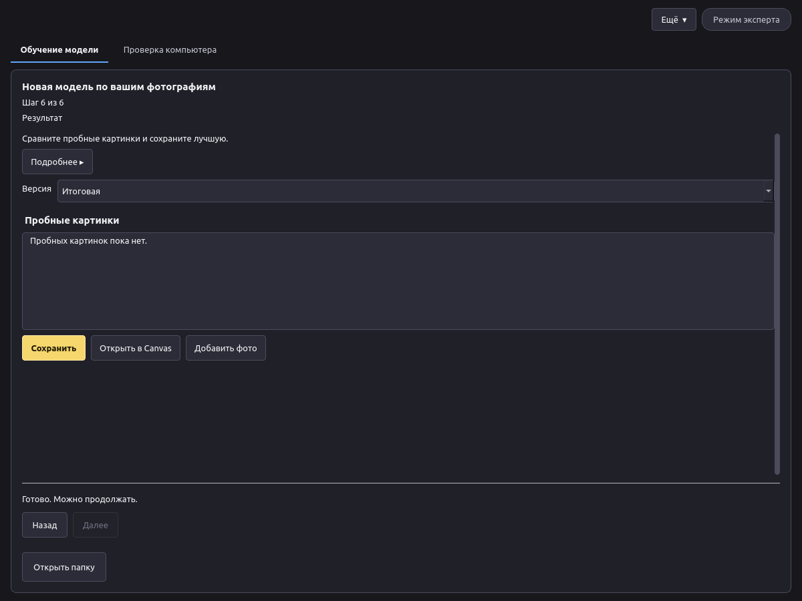

# Экспорт

## Шаг 6: Результат



1. Посмотрите пробные картинки и выберите **Версию**. Поздняя версия не всегда лучше; берите ту, что вам нравится.
2. **Сохранить** записывает один файл `.safetensors` с файлом описания (`voxprint-model.json`), лицензией и уведомлением. Его можно хранить или передавать на условиях лицензии основной модели.
3. **Открыть в Canvas** добавляет его к вашим моделям. В Canvas выберите LoRA, напишите ключевое слово в запросе и задайте силу (для начала подойдёт 0,8).

Чтобы улучшить модель позже, нажмите **Добавить фото** на этом шаге. Обучение продолжится с этой модели на новых фото и части старых.

## Где лежат файлы

- LoRA, отправленные через **Открыть в Canvas**: `%LOCALAPPDATA%\VOXPrint AI Suite\models\user-models\lora\<имя>\`.
- Проекты: `%LOCALAPPDATA%\VOXPrint AI Suite\state\model-forge\lora\`. **Ещё → Открыть проект…** открывает прежний проект; **Открыть папку** показывает его фото, версии и пробные картинки.
- Если удалить папку проекта, удалятся его фото, описания и версии. Сохранённые в другом месте файлы LoRA не затрагиваются.

## Что содержит файл модели

Введённые имена, ключевое слово, подтверждения согласия и 18+, способ согласия (устно или файл), пометку о материалах для взрослых, необязательную заметку о происхождении, отметку о приложенном разрешении и его отпечаток, а также настройки обучения. В нём нет фото, путей к файлам, имени пользователя, сведений о компьютере и метаданных фото.

## Командная строка

Тот же экспорт доступен из командной строки:

```text
voxprint-forge-cli lora export --project <папка проекта> [--checkpoint <шаг>] [--out <файл.safetensors>] [--install-to-mdl]
```

`--install-to-mdl` также добавляет LoRA к вашим моделям для Canvas. Подробнее — в [справочнике по командной строке](../../cli-reference.md) (на английском).
