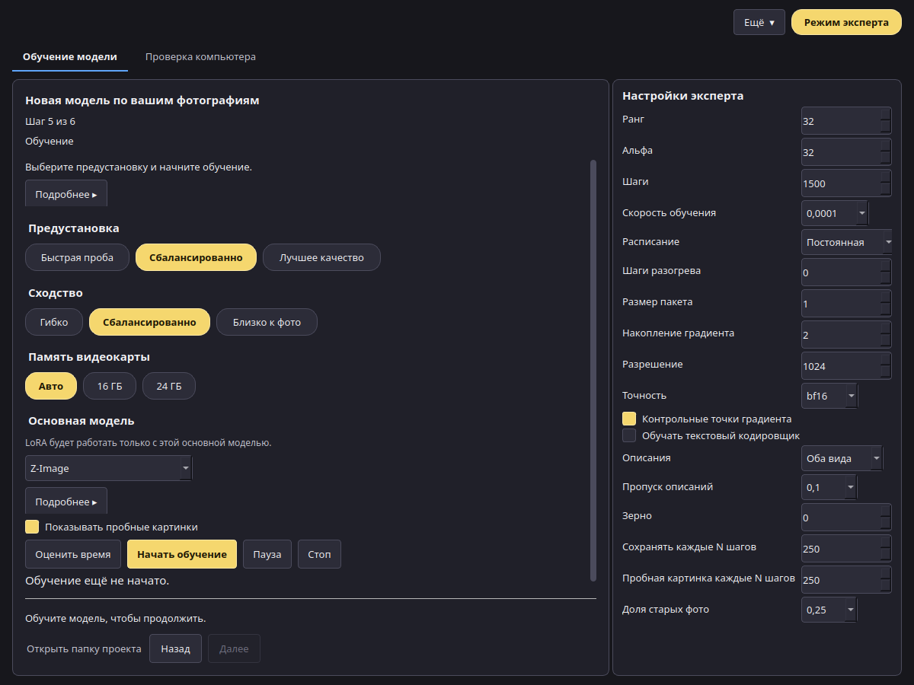

# Руководство пользователя Model Forge

*Версия 0.1 (кандидат в релиз). [English version](../en/index.md).*

Model Forge учит модель для картинок чему-то новому по вашим фотографиям: человеку, предмету или стилю. Результат — небольшой файл-дополнение, LoRA. Его можно использовать в VOXPrint AI Canvas, чтобы создавать новые картинки с этим человеком, предметом или в этом стиле.

Всё происходит на вашем компьютере. Фотографии, описания и обученная модель никуда не отправляются.

## Содержание

1. [Установка](install.md): требования, установка и удаление.
2. [Загрузка моделей](models.md): загрузчик моделей VOXPrint (MDL), источники, лицензии и место на диске.
3. [Создание проекта LoRA](project.md): фотографии, имена, согласие, подтверждение 18+ и необязательный файл разрешения.
4. [Предустановки](presets.md): «Быстрая проверка», «Сбалансированная» и «Лучшее качество», сходство, уровни видеопамяти и измеренные цифры.
5. [Обучение](training.md): проверка и подготовка фото, настройки, ход обучения, пауза и остановка.
6. [Экспорт](export.md): выбор версии, сохранение LoRA и работа с ней в Canvas.
7. [Тесты сжатия](compression.md): как проверяются сжатые части моделей, прежде чем приложение начнёт их использовать.
8. [Уровни оперативной памяти](memory.md): что означают 32, 64 и 96 ГБ.
9. [Решение проблем, конфиденциальность и лицензии](troubleshooting.md).

## Простой режим и режим эксперта

- **Простой режим** (по умолчанию) ведёт вас через шесть шагов с безопасными настройками. Вы выбираете предустановку, а числа подбирает приложение.
- **Режим эксперта** (кнопка **Режим эксперта** справа вверху) показывает все настройки обучения на панели справа.

Шаги показаны вверху окна. Когда **Дополнить набор по образцам** выключено, это: Фотографии, Кто или что на фото, Проверка и подготовка, Обучение, Результат. **Сбор набора** появляется после шага «Кто или что на фото» только пока переключатель включён, и счётчик считает только те шаги, которые можно открыть. На каждом шаге видна одна короткая строка. На шаге «Фотографии» эта строка называет выбранный сюжет, а в пустой области для снимков, пока вы не добавите фото, видна короткая подсказка. На остальных шагах **Подробнее ▸** открывает полное пояснение. **Открыть папку проекта** на одной линии с «Назад» и «Далее» открывает папку с фото, версиями и пробными картинками.

На снимках экрана в этом руководстве — демонстрационный проект с нейтральными картинками-заглушками.
