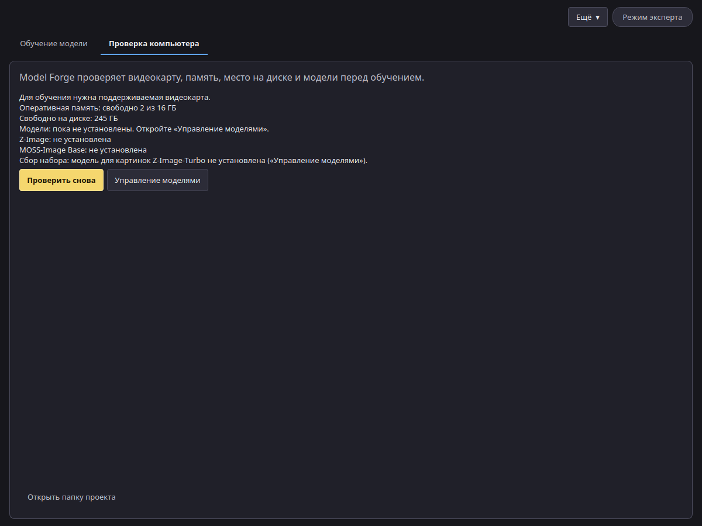

# Установка

## Требования

| | Минимум |
| --- | --- |
| Система | Windows 11 24H2 или новее, 64-разрядная. На Linux приложение запускается из исходного кода (см. README). |
| Видеокарта | NVIDIA с 16 ГБ видеопамяти (с 24 ГБ быстрее), серия RTX 30 или новее |
| Драйвер | Актуальный драйвер NVIDIA |
| Оперативная память | 32 ГБ. См. [уровни оперативной памяти](memory.md). |
| Диск | Около 45 ГБ свободного места: около 35 ГБ на модели, плюс приложение и ваши проекты. Если нужна ещё и MOSS-Image Base, добавьте около 27 ГБ. |
| Интернет | Нужен только для установки и первой загрузки моделей |
| PowerShell | Рекомендуется PowerShell 7. Если его нет, установщик предложит скачать и установить его с сайта Microsoft. Если отказаться или установка не удастся, установщик использует Windows PowerShell 5.1 и предложит установить PowerShell 7 позже ([как установить](https://learn.microsoft.com/powershell/scripting/install/install-powershell-on-windows)). |

## Установка в Windows

1. Запустите `VoxprintModelForgeSetup.exe` и подтвердите запрос администратора.
2. Установщик копирует приложение в `C:\Program Files\VOXPrint AI Suite\Model Forge`, затем загружает Python и нужные библиотеки. Это занимает несколько минут. Не отключайте интернет.
3. После завершения откройте **VOXPrint AI Model Forge** из папки **VOXPrint AI Suite** в меню «Пуск». Установщик может также создать ярлык на рабочем столе. Этот флажок выключен, пока его не включить.

Руководство открывается пунктом **Открыть руководство** в приложении. PDF-копии лежат в `C:\Program Files\VOXPrint AI Suite\Model Forge\docs`.

Если установка не удалась, установщик покажет путь к журналу: `C:\Program Files\VOXPrint AI Suite\Model Forge\setup-work\install.log`. Проверьте подключение к интернету и запустите установщик снова.

## Первый запуск

Откройте вкладку **Проверка компьютера**. На ней видны видеокарта, оперативная память, свободное место на диске и недостающие модели. Нажмите **Управление моделями**, чтобы загрузить их (см. [Загрузка моделей](models.md)), затем **Проверить снова**.

## Удаление приложения

Удалите приложение в разделе «Параметры» > «Приложения» > «Установленные приложения». В меню «Пуск» нет ярлыка удаления. Ваши проекты и загруженные модели остаются на месте. Как удалить и их, описано в разделе «Конфиденциальность» на странице [Решение проблем](troubleshooting.md).
