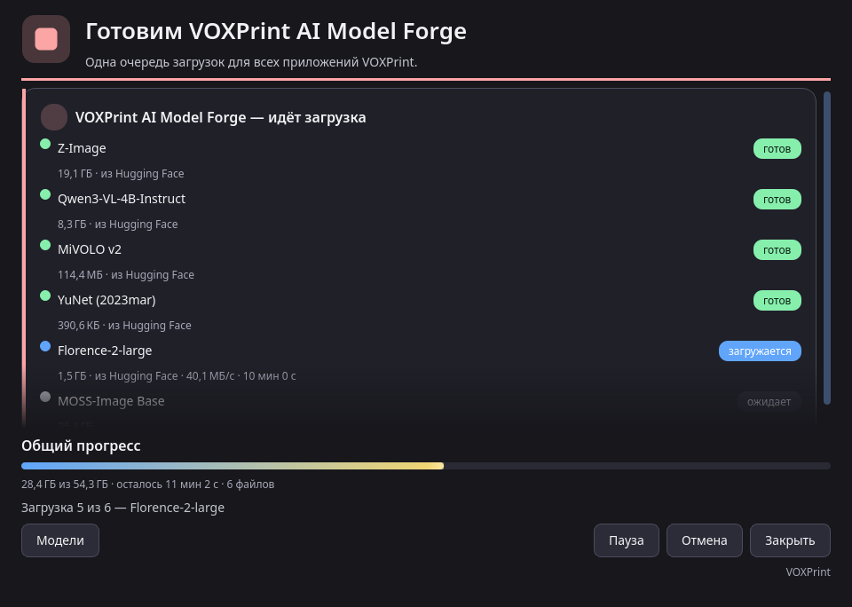

# Загрузка моделей (MDL)

Для обучения Model Forge нужны модели. Их нет внутри установщика, поэтому он небольшой. При первом запуске откройте вкладку **Проверка компьютера** и нажмите **Управление моделями**. Откроется загрузчик моделей VOXPrint (MDL) и загрузит недостающее.



| Модель | Что делает | Источник | Лицензия | Размер |
| --- | --- | --- | --- | --- |
| Z-Image (base) | Модель для картинок, на которой обучается LoRA | Tongyi-MAI/Z-Image | Apache-2.0 | 20,5 ГБ |
| Qwen3-VL-4B-Instruct | Пишет описания фото; нужна для подготовки фото | Qwen/Qwen3-VL-4B-Instruct | Apache-2.0 | 8,9 ГБ |
| MiVOLO v2 | Нужна для подготовки фото | iitolstykh/mivolo_v2 | Apache-2.0 | 0,1 ГБ |
| YuNet (2023mar) | Находит лица; нужна для подготовки фото | opencv/opencv_zoo | MIT | меньше 1 МБ |
| Florence-2-large | Запасная модель для описаний | microsoft/Florence-2-large | MIT | 1,6 ГБ |
| MOSS-Image Base | Вторая основная модель. Быстрее и помещается на карту 16 ГБ | OpenMOSS-Team/MOSS-Image-Base | Apache-2.0 | 27,2 ГБ |
| Z-Image-Turbo | Рисует картинки на шаге **Сбор набора** (необязательно) | Tongyi-MAI/Z-Image-Turbo | Apache-2.0 | 32,9 ГБ |
| DINOv2 base | Отмечает почти одинаковые картинки на шаге **Сбор набора** (необязательно) | facebook/dinov2-base | Apache-2.0 | 0,4 ГБ |

- **Источники.** Каждая модель загружается с официальной страницы автора, в закреплённой версии. Перед использованием загрузчик сверяет каждый файл с опубликованной контрольной суммой.
- **Лицензии.** У каждой модели своя лицензия. Прочитайте её в «Управлении моделями» до начала работы. Ваша LoRA наследует лицензию основной модели, на которой обучена.
- **Диск.** Модели сохраняются в общую папку моделей VOXPrint, по умолчанию `%LOCALAPPDATA%\VOXPrint AI Suite\models`. Другие приложения VOXPrint используют ту же папку, поэтому каждая модель загружается один раз.
- **Фоновая загрузка.** Если закрыть окно загрузчика, загрузка продолжится в фоне, а после обрыва связи возобновится. Кнопки **Пауза** и **Отмена** находятся внизу окна.

## Проверка и восстановление

На вкладке **Проверка компьютера** есть кнопка **Проверить и восстановить модели**. Окно прогресса открывается каждый раз, в том числе когда все файлы уже на месте. Каждая установленная модель проверяется по файлам: файл должен быть на месте, а его контрольная сумма должна совпасть. В окне модель получает состояние **ОК**, **нет файла** или **повреждён**. **Восстановить** заново скачивает только недостающие или повреждённые файлы с официального источника, сверяет закреплённую контрольную сумму и продолжает оборванную загрузку, если источник это позволяет. LoRA и проекты не изменяются. Подключаемая модель с официального источника восстанавливается по её адресу так же.

```text
voxprint-forge-cli models verify
voxprint-forge-cli models verify --repair
voxprint-forge-cli models verify --gui
```

`models verify` проверяет установленные модели и печатает `N models: X OK, Y damaged, Z missing`. Команда завершается с ошибкой, если что-то всё ещё повреждено или отсутствует. Слова в этой строке английские: OK, damaged, missing. `--repair` — та же проверка, и файлы исправляются без вопроса. `--gui` открывает окно проверки и восстановления командой `voxprint-mdl verify --app model-forge --gui` (и `--repair`, если указан этот флаг) и на Windows не показывает консоль. Кнопка «Проверить и восстановить модели» запускает `voxprint-mdl verify --app model-forge --gui --repair`. «Управление моделями» остаётся отдельным окном.

Чтобы удалить ненужную модель, снова откройте «Управление моделями»: там видны установленные модели, их размер и лицензия.
