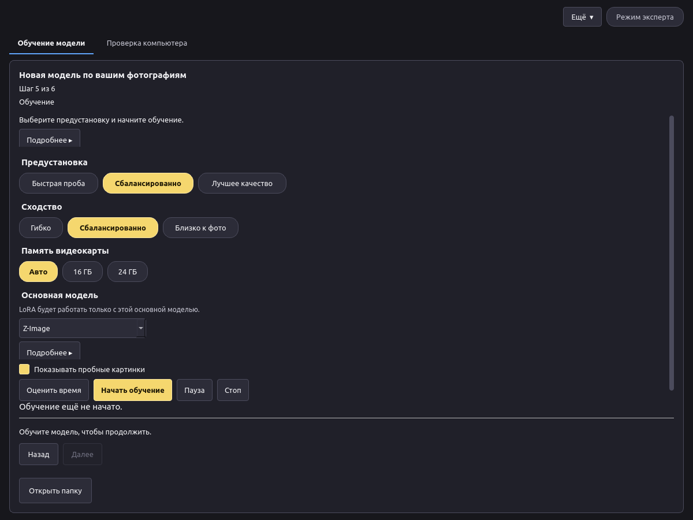

# Предустановки

На шаге **Обучение** вы выбираете предустановку, сходство и память видеокарты. Приложение превращает их в числа для обучения. В режиме эксперта любое число можно изменить на панели справа.

## Предустановка

| Предустановка | Шаги | Ранг LoRA | Скорость обучения | Размер картинки | Для чего |
| --- | --- | --- | --- | --- | --- |
| **Быстрая проба** | 600 | 16 | 0,0001 | 768 пикс. | Быстро посмотреть, что получается на ваших фото |
| **Сбалансированно** (рекомендуется) | 1500 | 32 | 0,0001 | 1024 пикс. | Большинство проектов |
| **Лучшее качество** | 3000 | 32 | 0,00008 | 1024 пикс. | Итоговая модель, когда время не важно |

## Сходство

Сходство меняет число шагов и то, как часто описание пропускается при обучении.

| Сходство | Шаги | Когда выбирать |
| --- | --- | --- |
| **Гибко** | 0,7 × предустановка | Объект должно быть легко помещать в новые сцены |
| **Сбалансированно** | как в предустановке | Большинство проектов |
| **Близко к фото** | 1,3 × предустановка | Картинки должны больше походить на ваши фото |

## Память видеокарты: 16 ГБ и 24 ГБ

**Авто** определяет вашу видеокарту: меньше 20 ГБ — уровень 16 ГБ, иначе уровень 24 ГБ. Можно выбрать **16 ГБ** или **24 ГБ** и вручную.

- На обоих уровнях обучение идёт по одной картинке с включёнными контрольными точками градиента. «Сбалансированно» и «Лучшее качество» складывают две картинки перед каждым шагом, «Быстрая проба» — одну.
- **Z-Image**, уровень 16 ГБ: основная модель хранится в компактном 8-битном виде, чтобы поместиться на карту. Уровень 24 ГБ: полная точность.
- **MOSS-Image Base**: модель для картинок на обоих уровнях работает в полной точности. Её текстовый кодировщик работает на видеокарте: на уровне 16 ГБ — сжатым до 8 бит, на уровне 24 ГБ — в полной точности (см. [Тесты сжатия](compression.md)).

## Измеренные цифры

Цифры получены при калибровке предустановки «Сбалансированно» (1024 пикс., ранг 32, одна картинка и два накопления на шаг) на RTX 4090, память которой ограничивали 16 ГБ или 22,5 ГБ, чтобы изобразить каждую карту.

| Основная модель | Уровень | Текстовый кодировщик | Время шага | Пик видеопамяти |
| --- | --- | --- | --- | --- |
| MOSS-Image Base | 16 ГБ | 8 бит, на видеокарте | 4,89 с | 13,6 ГБ |
| MOSS-Image Base | 24 ГБ | полная точность, на видеокарте | 4,90 с | 18,5 ГБ |
| Z-Image | 16 ГБ и 24 ГБ | полная точность | ещё не измерено | ещё не измерено |

Значит, обучение MOSS-Image Base с предустановкой «Сбалансированно» (1500 шагов) займёт на такой карте около 2 часов плюс несколько минут на загрузку. В списке основных моделей на шаге «Обучение» для MOSS-Image Base показан измеренный пик, для Z-Image — самая маленькая карта, под которую настроены предустановки (от 16 ГБ). Кнопка **Оценить время** даст прогноз для ваших настроек.
