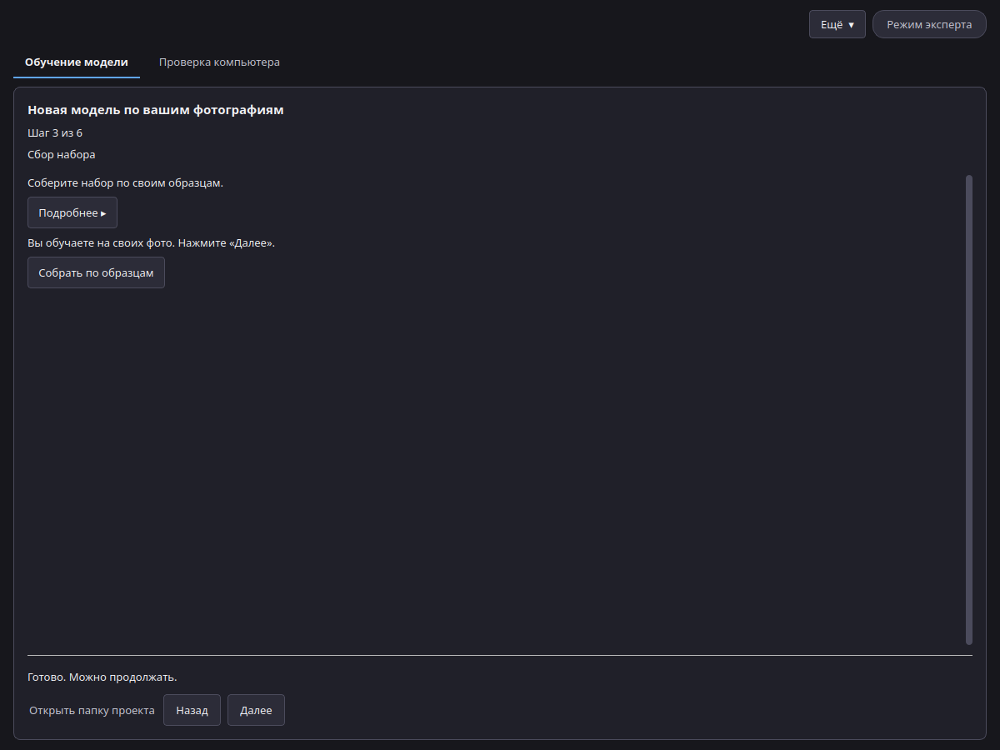

# Создание проекта LoRA

Начните с **Ещё → Новая модель**. Проект хранит в одной папке ваши фото, их описания, версии обучения и пробные картинки.

## Шаг 1: Фотографии

1. Нажмите **Добавить** и выберите **Добавить фото** или **Добавить папку** (JPG, PNG или WebP) либо перетащите фото или папку в окно.
2. Укажите, что на фото: **Человек** (один конкретный человек), **Предмет** (одна конкретная вещь или изделие) или **Стиль** (общий вид: свет, цвета, подача, настроение).
3. Оставьте **Дополнить набор по образцам** выключенным, чтобы обучать на этих фото. Включите, чтобы перед обучением нарисовать ещё картинки по ним (см. ниже).

Хорошие фото — хорошая модель:

- Обычно хватает 15–20 чётких фото. Рекомендуется от 10 до 30 фото. Допустимо в режиме эксперта: от 5 до 60 фото.
- Меняйте ракурс, освещение, фон и одежду.
- Один объект на фото. Избегайте групповых снимков, сильных фильтров и почти одинаковых кадров.
- Для стиля берите картинки в одном стиле, но с разным содержанием.

## Шаг 2: Кто или что на фото

- **Имя** или **Сценическое имя**: достаточно одного. **Ключевое слово** — это слово, которое вы потом напишете в Canvas, чтобы вызвать модель; приложение предложит его само. Если вы укажете сценическое имя, оно станет ключевым словом; его можно изменить.
- **Согласие получено** (для человека): отметьте, если человек согласился на такое использование. Затем либо отметьте **Устно** рядом, если согласие дано на словах, либо нажмите **Приложить разрешение модели** и выберите файл. С отметкой **Устно** файл не нужен.
- **Файл разрешения** (необязательно): приложенное разрешение остаётся в папке проекта. В файл модели попадают только отметка о том, что оно есть, и его отпечаток.
- **Человеку 18 лет или больше**: отметьте, чтобы подтвердить, что человек совершеннолетний. Без этой отметки проект с человеком не продолжится.
- **Данные содержат материалы для взрослых (18+)**: появляется рядом, когда отмечен пункт **Человеку 18 лет или больше**. По умолчанию выключено. Отметьте, если на фото есть материалы для взрослых; приложения, например Canvas, используют эту пометку для сортировки и фильтрации моделей.
- **Атрибут субъекта** (необязательно): оставьте пустым, если он вам не нужен. Допустимые значения показаны во всплывающей подсказке.
- **Предмет** или **Стиль**: подтвердите, что у вас есть право использовать эти фото. Стиль нельзя выдавать за работу конкретного ныне живущего художника.
- **Заметка о происхождении** (необязательно): откуда эти фото.

На каждом фото должны быть только взрослые люди, давшие согласие, и у вас должно быть право использовать это фото. Некоторые фото при подготовке могут быть отклонены; замените их другими фото того же объекта.

## Шаг 3: Сбор набора (необязательно)

Если вы обучаете на своих фото, этот шаг просто сообщает об этом; нажмите **Далее**. Если хороших снимков мало, включите **Дополнить набор по образцам** на шаге 1 или нажмите **Собрать по образцам** здесь и используйте от 1 до 10 фото одного объекта. Затем:

1. Нажмите **Нарисовать**. Приложение нарисует по вашим образцам круг новых картинок моделью Z-Image-Turbo.
2. Отметьте каждую удачную картинку (или щёлкните по ней). Картинки без отметки не используются.
3. Нажмите **Следующий круг**, чтобы нарисовать ещё по оставленным картинкам и образцам. Повторяйте, пока набор вас не устроит.
4. Нажмите **Готово, это оно**. Образцы и оставленные картинки станут набором для обучения.

В простом режиме за круг рисуется 24 картинки. В режиме эксперта на панели справа можно задать **Картинок за круг**, **Силу изменений** и **Шаги**. Картинки с пометкой **≈ очень похожа на другую** почти не отличаются от другой; оставьте только одну из них. Некоторые картинки могут быть отклонены и не показываются. **Начать заново** забывает круги и сохраняет образцы.

Дальше: [Предустановки](presets.md) и [Обучение](training.md).
