# Обучение

## Шаг 4: Проверка и подготовка

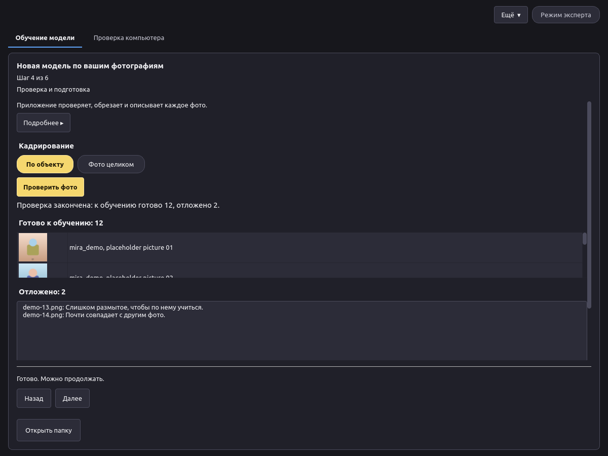

1. Выберите кадрирование: **По объекту** или **Фото целиком**.
2. Нажмите **Проверить фото**. Приложение проверяет каждое фото, кадрирует его и пишет к нему короткое описание. Ключевое слово добавляется в каждое описание, чтобы модель связала его с вашим объектом.
3. Просмотрите список. В разделе **Готово к обучению** — фото, которые будут использованы, с их описаниями. В разделе **Отложено** — фото, которые не будут использованы, с причиной для каждого (например, слишком размыто или почти не отличается от другого фото).

Перед обучением можно убрать любое фото. Если фото осталось слишком мало, добавьте ещё на шаге 1.

## Шаг 5: Обучение

Выберите предустановку, сходство и память видеокарты (см. [Предустановки](presets.md)), а также основную модель:

- **Основная модель** — модель для картинок, на которой обучается LoRA. LoRA будет работать только с этой основной моделью, поэтому в Canvas выберите её же. **Z-Image** лучше всего для максимального качества и работает медленнее. **MOSS-Image Base** быстрее и помещается на карту 16 ГБ. Вторая строка каждого варианта говорит, для чего он лучше всего и сколько нужно видеопамяти.

  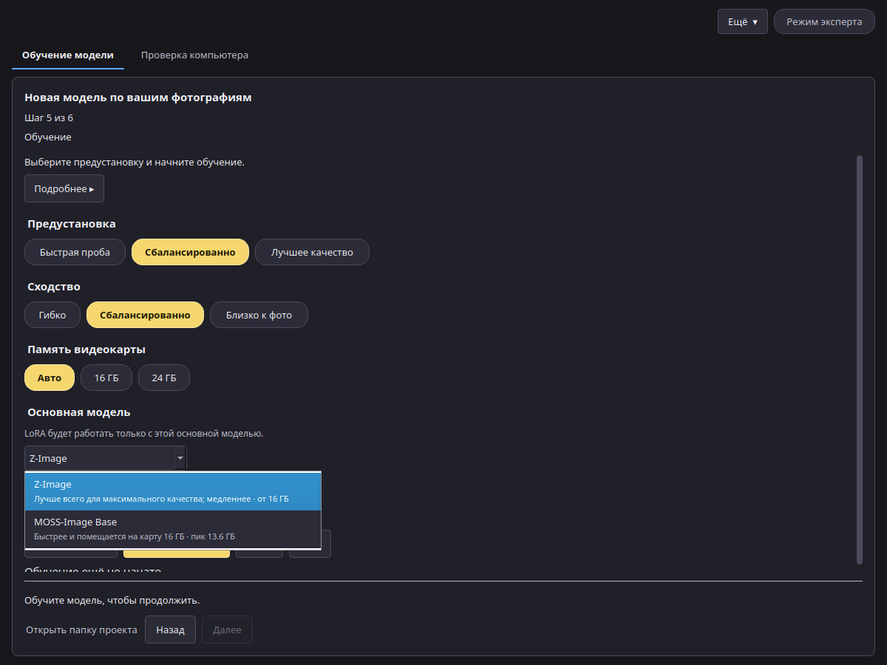

- **Подробнее ▸** под каждой настройкой объясняет её. В подробностях об основной модели указана измеренная видеопамять.

  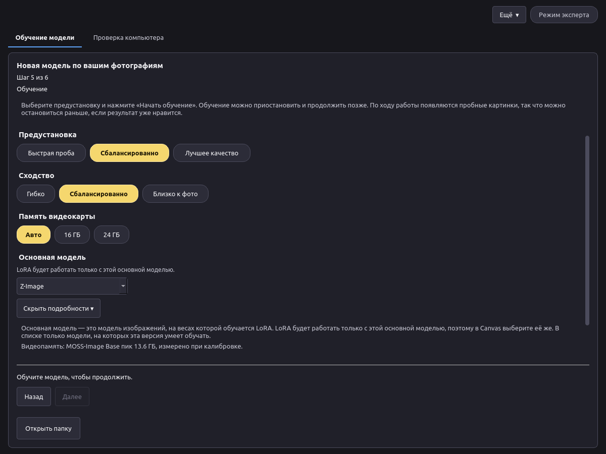

- **Показывать пробные картинки** — переключатель. Пока он включён, во время обучения рисуется несколько картинок, чтобы был виден результат. Это не те картинки, которые вы отмечаете между раундами.

В **Подробнее** на этом шаге, когда включены раунды просмотра, есть поле **Число раундов** (от 1 до 6, по умолчанию 3) и поле **Шаги первого раунда** (от 100 до 500, по умолчанию 120). Число раундов — сколько раз обучение остановится на проверку. Шаги первого раунда — длина этапа до первой проверки. Пока этап идёт, **Оценить время** неактивна, как и **Начать обучение**.

Нажмите **Оценить время**, чтобы увидеть прогноз, затем **Начать обучение**. Пока этап идёт, шаг говорит, что идёт обучение, а предустановка, сходство, память и основная модель заблокированы. Кнопки **Начать обучение** и **Оценить время** выглядят неактивными. Строка показывает шаг из общего числа, сколько этап уже идёт и сколько осталось, в часах и минутах. В первом раунде та же строка говорит, когда будут первые картинки: оставшиеся шаги, умноженные на измеренные секунды на шаг, плюс оставшиеся картинки, умноженные на секунды на картинку. Пока ни одна картинка не измерена, один шаг рисования оценивается как половина шага обучения. Когда время картинки уже измерено, строка показывает и секунды на картинку. Полоса под строкой заканчивается процентом. Потери — в **Подробнее**. Доступны **Пауза** и **Стоп**. **Стоп** спрашивает, прежде чем остановить обучение.

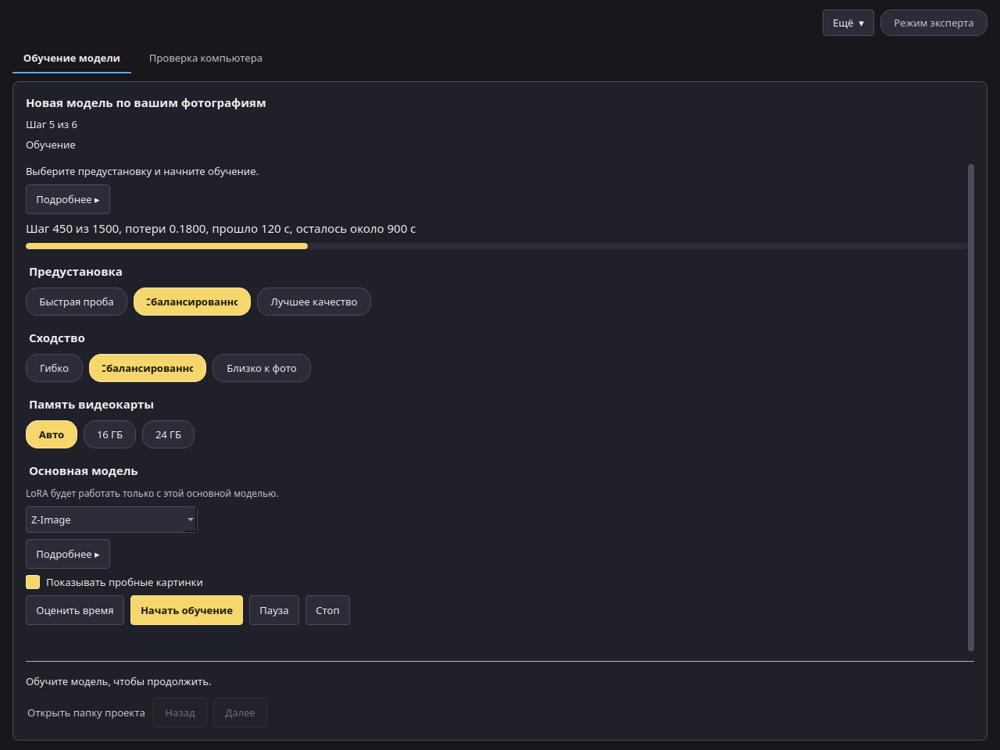

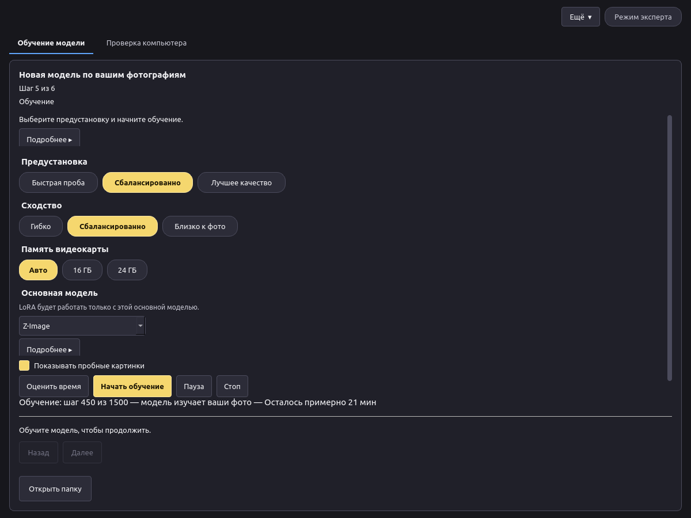

- **Пауза** сохраняет версию и останавливает обучение. Позже нажмите **Продолжить**, чтобы продолжить с этой версии.
- **Стоп** спрашивает, затем завершает обучение. Уже сохранённые версии остаются.
- За время обучения приложение шесть раз сохраняет версию, чтобы на следующем шаге их можно было сравнить.

## Раунды просмотра

Если на шаге «Фотографии» включено **Дополнить набор по образцам**, обучение останавливается на проверку. **Число раундов** (от 1 до 6, по умолчанию 3) задаёт, сколько будет таких остановок. Первый этап — это **Шаги первого раунда** (по умолчанию 120, от 100 до 500). Затем приложение рисует 6 картинок в том же размере, что и обучение, по 28 шагов рисования. Следующие раунды рисуют по 8 картинок, тоже по 28 шагов. Оставшиеся шаги предустановки (все шаги минус шаги первого раунда) делятся поровну между оставшимися запланированными раундами, и последний забирает остаток. Общее число шагов предустановки не меняется. Если запланирован один раунд, он длится только как первый; оставшиеся шаги доучивает режим **Просто продолжить**.

Заголовок — **Проверьте новые картинки**. Ваши фото остаются рядом с новыми. У каждой новой картинки есть **Взять** и **Не брать**. Взятая картинка получает золотую рамку и галочку. Отложенная тускнеет, с красноватой рамкой и крестиком. Картинка без отметки остаётся обычной.

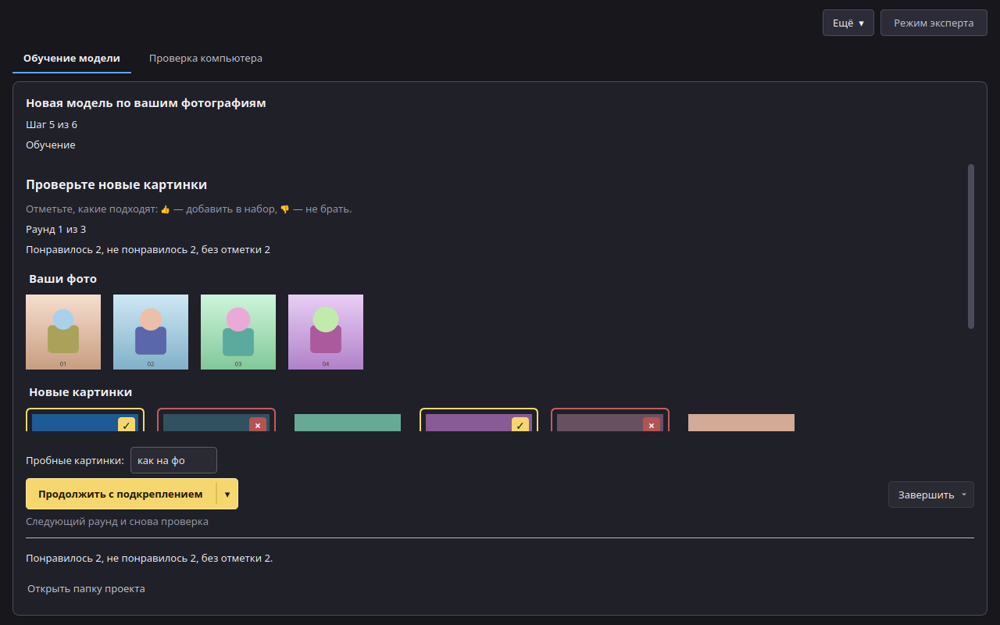

**Отметить все 👍** берёт все новые картинки. **Сбросить** снимает отметки. Внизу видно, сколько взято, сколько отложено и сколько без отметки. Над рядом кнопок список **Пробные картинки**: **как на фото**, **в одежде** или **без одежды**. Выбор хранится в проекте и действует со следующего раунда. Каждая картинка собирается из ключевого слова, кадра (крупный портрет, по пояс или в полный рост) и одного слова про одежду. **Как на фото** повторяет описания: без одежды, если хотя бы одно описание так отмечено, иначе одеты, как на фото. Список сам одежду не добавляет. В одном ряду слева большая кнопка, справа маленькая **Завершить**. По умолчанию большая кнопка — **Продолжить с подкреплением**: она обучает следующий раунд и снова останавливается на проверку. Узкий **▾** на её правом краю переключает надпись на **Просто продолжить** и делает кнопку спокойнее, с короткой сменой надписи. **Просто продолжить** берёт уже выбранные картинки и доучивает оставшиеся шаги без новых проверок. Повторное нажатие **▾** возвращает подкрепление. Выбор сохраняется в настройках проекта. **Завершить** открывает меню. **Сохранить** сначала спрашивает и показывает, сколько шагов пройдено из запланированных, затем сохраняет модель и рисует итоговую пробную картинку. Получается готовая LoRA, которую можно экспортировать. На экране результата, в `train.json` и в данных экспорта (`steps` и `steps_planned`) записано, сколько шагов она прошла, например «Завершено на 450 из 1500 шагов». **Принудительно, без сохранения** сначала спрашивает, затем останавливает обучение и удаляет временные версии и пробные картинки проекта. Ничего не сохраняется. Ваши фото остаются. Если какая-то картинка без отметки, **Продолжить с подкреплением** и **Просто продолжить** спрашивают подтверждение: неотмеченные картинки не войдут в набор. Под кнопками одна короткая приглушённая строка называет текущий режим большой кнопки и меняется, когда ▾ переключает его. Полные объяснения — во всплывающих подсказках у большой кнопки, ▾, «Завершить» и каждого пункта меню. Закончить можно и раньше последнего раунда. **Назад** и **Далее** скрыты. Если закрыть приложение во время просмотра, тот же экран откроется снова вместе с проектом.

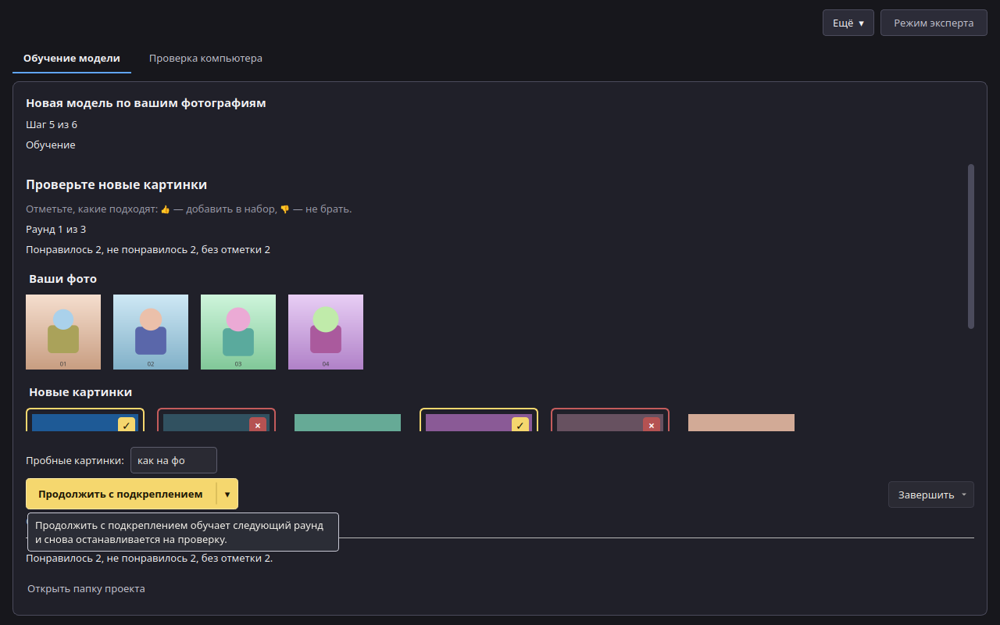

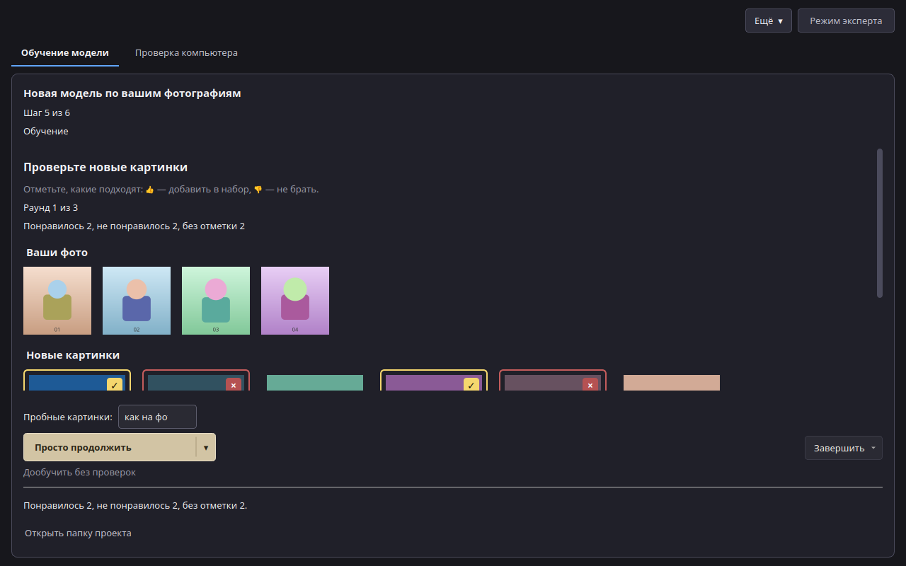

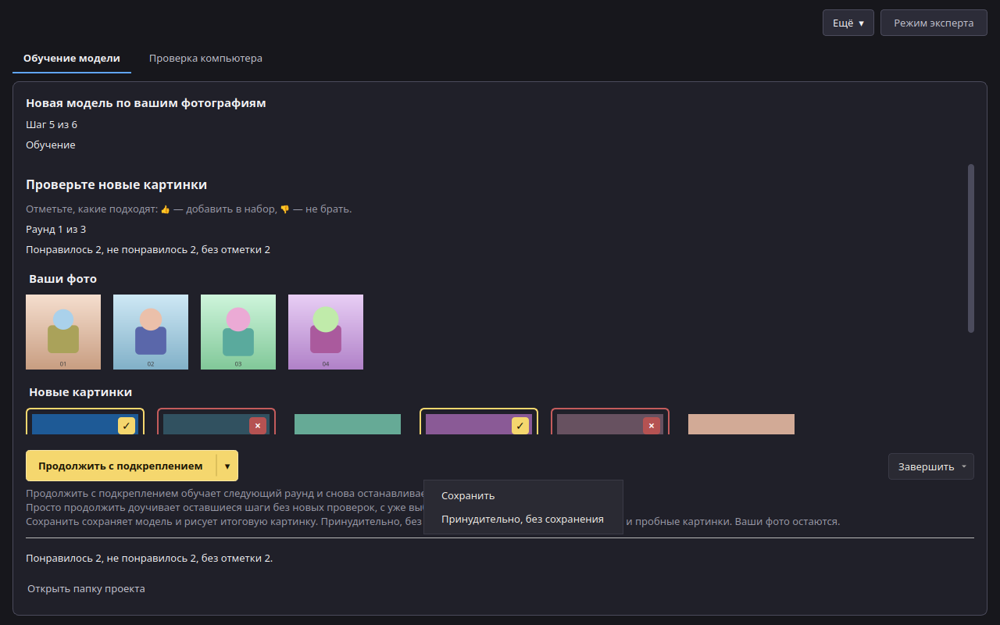

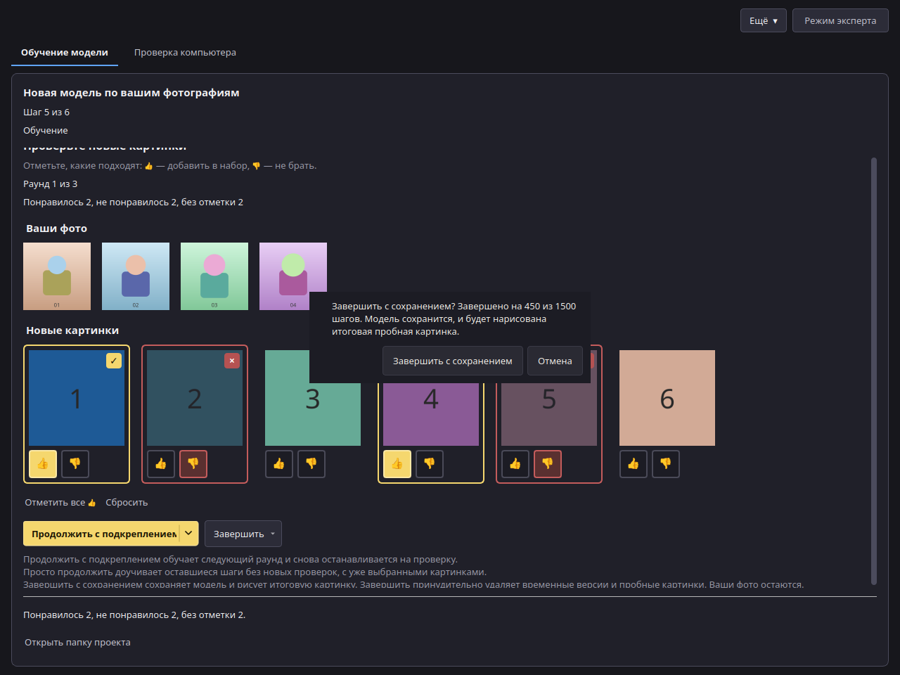

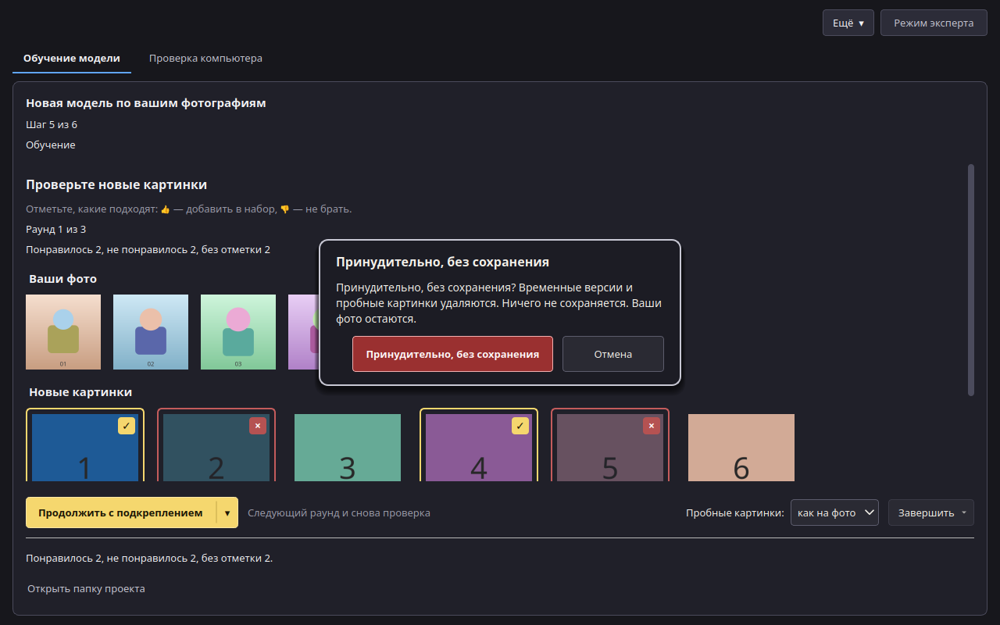

В командной строке то же делает `lora train --review-rounds N --first-round-steps 120 --first-round-samples 6 --samples-per-round 8 --sample-steps 28 --sample-attire auto`. `--sample-attire` — это `auto` (по умолчанию), `as_photos`, `clothed` или `unclothed`; значение хранится в проекте. N — от 1 до 6, по умолчанию 3. `lora review` показывает картинки и ставит отметки (`--like`, `--dislike` или `--from-file`). `lora continue PROJECT` запускает следующий раунд и снова останавливается на проверку. `lora continue PROJECT --unattended` доучивает оставшиеся шаги без новых проверок. `lora finish PROJECT` сохраняет модель, рисует итоговую пробную картинку и записывает пройденные шаги. `lora finish PROJECT --discard` останавливает обучение и удаляет временные версии и пробные картинки; без терминала нужна ещё `--yes`. Ваши фото остаются. `lora status` в первом раунде печатает ту же строку про первые картинки. `--review-rounds 0` обучает без остановок на просмотр.

## Настройки эксперта

В режиме эксперта панель справа показывает все значения: Ранг, Альфа, Шаги, Скорость обучения, Расписание, Шаги разогрева, Размер пакета, Накопление градиента, Разрешение, Точность, Контрольные точки градиента, Обучать текстовый кодировщик, Описания, Модель для описаний, Пропуск описаний, Зерно, Сохранять каждые N шагов и Пробная картинка каждые N шагов. Кнопка **Сбросить** рядом с предустановками возвращает значения выбранной предустановки.

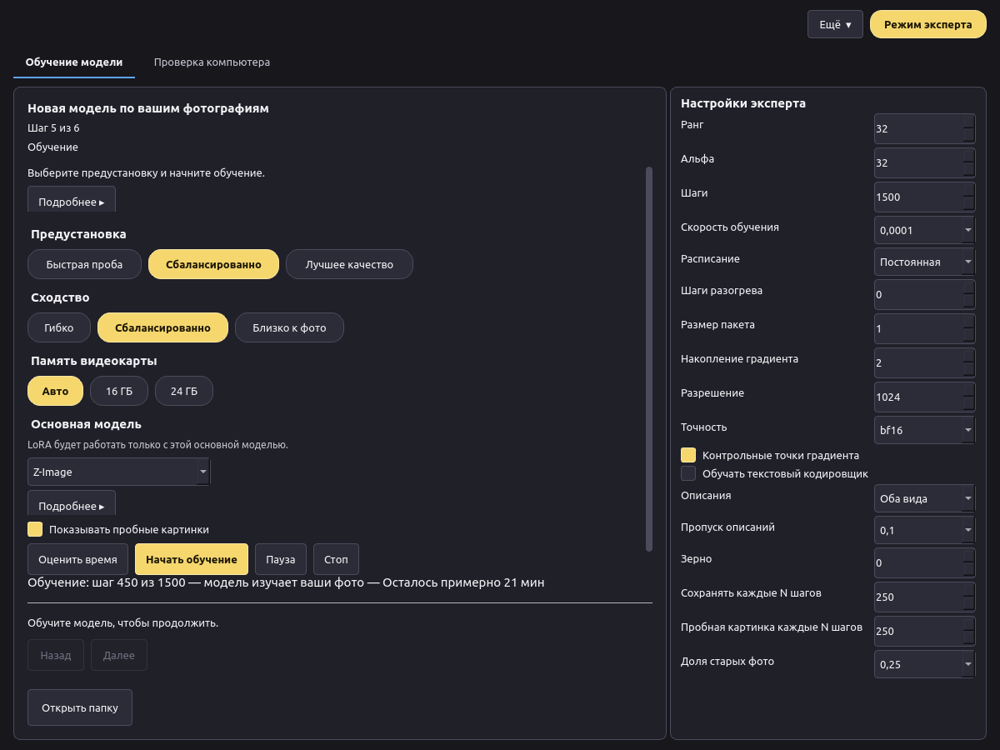

Рекомендуется от 10 до 30 фото. Допустимо в режиме эксперта: от 5 до 60 фото.
